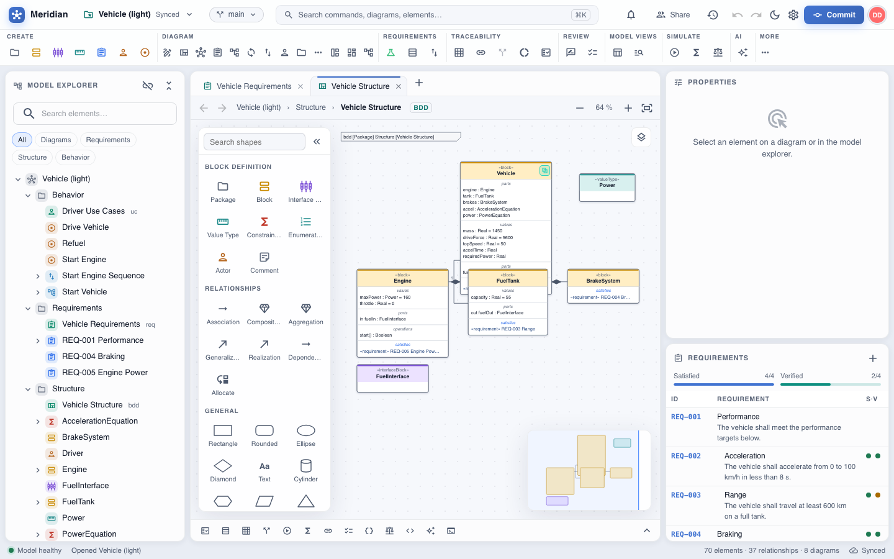
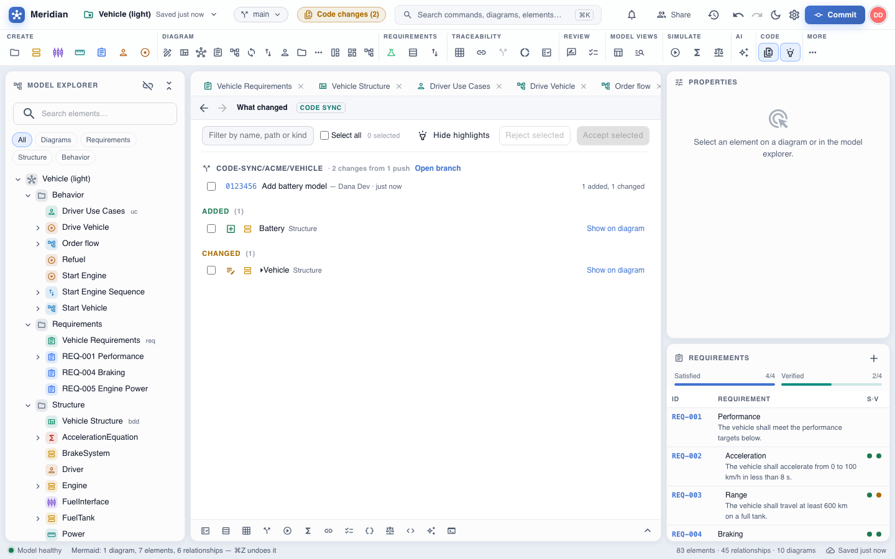
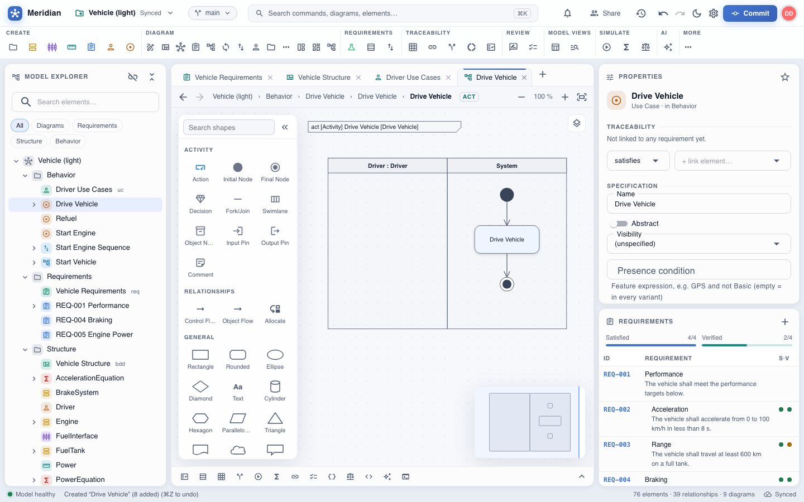
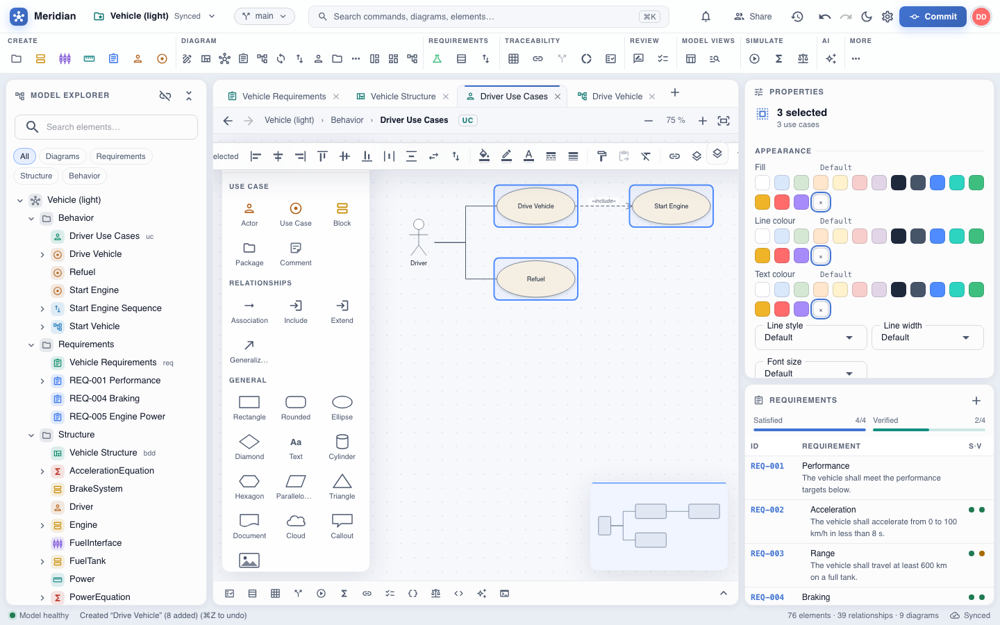
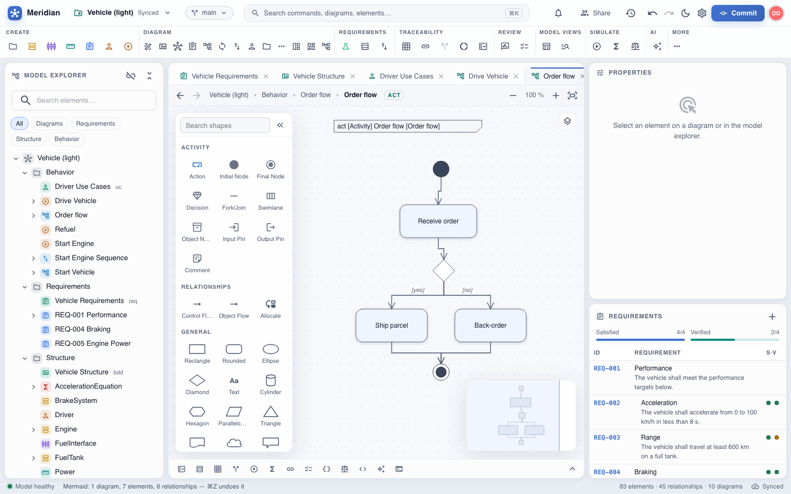

# Meridian

Model-based systems engineering that is as easy to draw with as a whiteboard. Meridian is SysML block,
internal block, requirement, activity, state machine, sequence, use case and parametric diagrams, all
linked to requirements and traceability. It also covers BPMN, ArchiMate, ER/database diagrams and free
drawing, with live multi-user editing. It is built with C#, Blazor and MudBlazor.

It runs as a **web app** (a team server backed by PostgreSQL) and as a **desktop app** for Windows, macOS
and Linux. The desktop app works offline on your computer or connects to a team server.

<picture>
  <source media="(prefers-color-scheme: dark)" srcset="docs-site/images/workbench-dark.png">
  
</picture>

The user guide is in [`docs-site/`](docs-site/) (built with DocFX). Release builds and the Docker image include it and serve
it at `/guide` (**Help (?) ▸ User guide** in the app), so it needs no public hosting and works offline.

## Download

Get the latest build from [Releases](../../releases) (on a GitLab copy of the repository: *Deploy ▸ Releases*):

| Platform | File | Notes |
| --- | --- | --- |
| macOS (Apple silicon) | `Meridian-<ver>-macos-arm64.zip` | Unzip, then drag **Meridian.app** to Applications. Not notarized yet: right-click → Open the first time. |
| macOS (Intel) | `Meridian-<ver>-macos-x64.zip` | Same as above. |
| Windows 10/11 x64 | `Meridian-<ver>-windows-x64.zip` | Unzip and run `Meridian.exe`. Needs the WebView2 runtime, which Windows 11 already has. |
| Linux x64 | `Meridian-<ver>-linux-x64.tar.gz` | Needs WebKitGTK 4.1. Run `./Meridian` or `./install.sh`. |
| Server (web version) | `Meridian-Server-<ver>.zip` | Needs the ASP.NET Core 10 runtime. You can also use Docker (below). |

When it first starts, the desktop app asks where to work:

- **This computer**: a private offline workspace. Data lives in a SQLite file in your user data folder
  (`~/Library/Application Support/Meridian`, `%APPDATA%\Meridian` or `~/.config/Meridian`). There is
  no account to create. Version history and comments still work.
- **Team server**: enter the address of a Meridian server to sign in, share projects and edit together
  in real time.

You can change the choice later from your avatar menu (**Switch workspace or server…**).

## Features

New in **0.6 and 0.7** (marked ★): database modelling with subject areas, used projects (shared libraries), package
permissions, DOORS Next and Polarion sync, simulation-driven requirement verification and variants on diagrams,
TypeScript / Java / Python code sync with submodules, pull request previews and architecture checks, the tabbed
ribbon, and a guided tour for people coming from Cameo or EA.
Earlier: code sync, creating diagrams from diagrams, Mermaid, more AI providers and multi-select (0.5); Settings and
themes, Auto-diagram and one-click SDD (0.4).

**Coming from Cameo or Enterprise Architect?** Open your `.mdzip` or `.qea` directly, then see
[Coming from Cameo / EA](docs-site/docs/migration.md) or **Help (?) ▸ Coming from Cameo or EA** in the app.

- **Drawing as easy as draw.io**
  - A searchable shapes panel: click to add, drag to place.
  - Hover arrows that add connected shapes; ★ lines pick their relationship type (satisfy, verify, composition…)
    and a chip switches it in one click.
  - Alignment guides and resize handles.
  - Double-click empty canvas to add a shape; start typing to label one.
  - A format bar for fill, line and text colors and line width, with a format painter.
  - ★ **Multi-select** shapes and connectors, edit them together in the Inspector, and **Link to…** one element in a
    single undo step. ([guide](docs-site/docs/multi-select.md))
- **Generate diagrams**
  - **Auto-diagram** draws a package overview, structure, internal structure, requirement and behavior views from
    the model, with no AI.
  - ★ **Create diagrams from diagrams**: requirements → use cases → activity → sequence → BDD / IBD → state machine,
    reviewed before anything changes, with **Update from source** that keeps your edits.
    ([guide](docs-site/docs/derivation.md), [reference](docs/DERIVATION.md))
- **SysML and UML**
  - Block definition, internal block (ports, item flows), parametric (with an equation solver), activity
    (swimlanes, pins, call behavior), state machine (composite states), sequence (fragments), use case,
    package and class diagrams.
  - Profiles and stereotypes, including UAF.
- **Requirements**
  - A requirements table, traceability matrix, traceability table and impact analysis.
  - Satisfy, verify, refine, derive and trace links, plus allocation.
  - ★ **Verification**: give a requirement a criterion (`mass <= 1500 kg`) and **Simulate ▸ Verify** checks it with
    parametrics, Monte Carlo, timed simulation or co-simulation; pass / fail shows on diagrams.
    ([guide](docs-site/docs/verification.md), [reference](docs/VERIFICATION.md))
  - ★ **DOORS Next and Polarion** two-way sync, plus ReqIF, CSV and Excel round trips.
- ★ **Database modelling**: crow's-foot diagrams with tables, views, keys, indexes and colour-framed **subject areas**;
  DDL / `.dacpac` / live-database import with refresh, DDL and migration scripts for five dialects, a data dictionary.
  ([guide](docs-site/docs/database.md), [reference](docs/DATABASE.md))
- **Other languages**: BPMN 2.0, ArchiMate 3, C# reverse engineering, and a free-drawing whiteboard.
- **Code sync**: connect a GitHub, GitLab or Bitbucket repository (C#, ★ TypeScript, Java, Python, ★ submodules); each
  push updates a review branch of the model, pull requests get a preview, diagrams highlight what changed, and you
  accept or reject **Code changes** into `main`. ★ **Architecture checks** flag code dependencies the model does not
  allow. ([guide](docs-site/docs/code-sync.md), [reference](docs/CODE-SYNC.md), [checks](docs/ARCHITECTURE-CHECKS.md))
- ★ **Used projects**: reuse a package of another project, read-only and pinned to a version, branch or baseline,
  with an update review. ([guide](docs-site/docs/libraries.md), [reference](docs/LIBRARIES.md))
- **AI assistant**: ask about the model, review it, generate requirements and trace links, or **Diagram my model**.
  Every change is shown as a diff you apply or discard. Runs on Claude (API key), ★ a local model (Ollama, LM Studio
  or any OpenAI-compatible server) or ★ Claude Code with your own login.
  ([guide](docs-site/docs/ai-assistant.md), [reference](docs/AI.md))
- **AI assistants over MCP** (team server): Hearth, Claude Code and other MCP clients read your models with read-only
  tools at `/api/mcp`, using a personal access token and your package permissions. ([guide](docs-site/docs/mcp.md))
- **Simulation**: step through activities and state machines.
- **Safety & reliability**: FMEA worksheet on blocks, parts and functions (S/O/D, RPN, AIAG-VDA action priority,
  mitigating requirements, verifying tests, CSV) and fault tree diagrams (AND / OR / k-of-n gates) with minimal cut sets,
  exact top-event probability and importance measures. ([guide](docs-site/docs/safety.md), [reference](docs/SAFETY.md))
- **FMI co-simulation**: import FMI 2.0 / 3.0 FMUs as blocks, wire them with native parametric blocks in an IBD and run them
  with a fixed-step master (plots, CSV, requirement checks). See [docs/FMI.md](docs/FMI.md).
- **Exchange**
  - XMI 2.5.1 (with diagrams), SysML v2 text, ReqIF, BPMN XML and ArchiMate exchange files.
  - Cameo / MagicDraw `.mdzip` and Enterprise Architect `.qea` import.
  - ★ **Mermaid** import (flowchart, class, state, sequence, requirement, ER and C4) and export.
    ([guide](docs-site/docs/mermaid.md), [reference](docs/MERMAID.md))
  - ★ **draw.io** import and export (`.drawio`, `.drawio.svg`, `.drawio.png`): UML pages become model elements at their drawn
    positions, other pages whiteboard drawings; and **folders of diagrams** (Mermaid and draw.io, one package per folder,
    re-import updates in place). ([reference](docs/DRAWIO.md))
  - A read-only SysML v2 REST API.
- **Reports**: program deliverables (SRS, ICD, SDD, VCRM / test report, model overview) as PDF, Word and HTML from
  editable templates: numbered sections, TOC, lists of figures / tables, captions and cross-references, query-driven
  loops and tables, traceability matrices and vector diagrams. Templates are stored in the model or as JSON. Plus SVG export.
- **Settings and themes**: light, dark or match system, accent colors, density and font size; settings follow your
  account. ([guide](docs-site/docs/settings.md))
- **Getting started**: a guided tour with chapters for each feature, including one for Cameo and EA users
  (**Help (?) ▸ Tour**), a one-time "What's new" card after an upgrade, ⌘K that also understands Cameo / EA names
  ("dependency matrix", "report wizard"), and empty projects that offer Paste Mermaid, Open a Cameo file, Start from a
  sample and Auto-diagram.
- **Collaboration** (server)
  - Accounts and project roles (owner, editor, viewer), and ★ **package permissions** (none, read, edit, manage per
    person or team). ([guide](docs-site/docs/permissions.md))
  - Live co-editing with presence, branches and merge, baselines, reviews and comments.
  - Version history with diff and restore.

<table>
  <tr>
    <td width="50%">
      <picture>
        <source media="(prefers-color-scheme: dark)" srcset="docs-site/images/code-changes-dark.png">
        
      </picture>
      <br><sub>Code sync: Code changes</sub>
    </td>
    <td width="50%">
      <picture>
        <source media="(prefers-color-scheme: dark)" srcset="docs-site/images/derive-activity-dark.png">
        
      </picture>
      <br><sub>Create from…: an activity from a use case</sub>
    </td>
  </tr>
  <tr>
    <td width="50%">
      <picture>
        <source media="(prefers-color-scheme: dark)" srcset="docs-site/images/multi-select-dark.png">
        
      </picture>
      <br><sub>Multi-select and the bulk Inspector</sub>
    </td>
    <td width="50%">
      <picture>
        <source media="(prefers-color-scheme: dark)" srcset="docs-site/images/mermaid-result-dark.png">
        
      </picture>
      <br><sub>A Mermaid flowchart, imported</sub>
    </td>
  </tr>
</table>

## Run the server

With Docker (PostgreSQL included):

```bash
docker compose --profile app up -d --build    # → http://localhost:8180
```

From source (needs the .NET 10 SDK):

```bash
docker compose up -d db                                   # PostgreSQL on 127.0.0.1:5433
cp src/Meridian.Web/appsettings.Development.example.json src/Meridian.Web/appsettings.Development.json
dotnet run --project src/Meridian.Web --urls http://localhost:5180
```

In development, the users listed under `DevSeed` are created when the server starts. Change their passwords
in your local `appsettings.Development.json`, which git ignores.

For production (HTTPS with Caddy, Kubernetes with Helm, backups, upgrades, scaling, monitoring and a hardening
checklist), follow **[docs/DEPLOYMENT.md](docs/DEPLOYMENT.md)**. Signed multi-arch images are published to
`ghcr.io/finepointcgi/meridian` for every release tag; a GitLab copy publishes the same image to its own GitLab
Container Registry (`registry.gitlab.com/<group>/<project>`).

To run with a single SQLite file instead of PostgreSQL, set `Meridian__Storage=sqlite` and
`Meridian__DataPath=<folder>`.

## Scripting and plugins

- **Script console** (dock tab *Script*, or ⌘K → "Script console"): C# scripts against a stable model API
  (`Model`, `Selection`, `Log(...)`), run as one undo step with a time limit and Cancel. See [docs/SCRIPTING.md](docs/SCRIPTING.md).
- **Plugins**: .NET assemblies implementing `IMeridianPlugin` add commands, validation rules, exporters and importers.
  See [docs/PLUGINS.md](docs/PLUGINS.md) and the sample in `samples/HelloPlugin`.

> **Security.** Scripts and plugins are arbitrary .NET code running inside the Meridian process with its permissions.
> The script policy (no file system, process, network or reflection APIs by default) is a guard rail, **not a sandbox**.
> The console is on by default only in the desktop app (local mode). On a server it is off unless an administrator sets
> `Meridian:Scripting:Enabled=true`, and even then only server administrators can run scripts (or also project owners with
> `Meridian:Scripting:AllowProjectOwners=true`). Plugins load only from
> `Meridian:Plugins:Path` on a server, so only someone with access to the server's disk can install them.
### Administration, single sign-on and backups (server mode)

The first account registered on a server (or any username listed in `Meridian:Admins`) is a server
administrator. Administrators get an **Administration** entry in the avatar menu (`/admin`) with tabs for
users (create, disable, reset password, unlock, make admin), organizations and teams (a team can be given a
role on any project; a member's effective role is the higher of their direct and team roles), all projects
(owner, size, rename, transfer, delete), a filterable audit log with CSV export, and backups. None of this
appears in the desktop app's local mode.

Single sign-on uses OpenID Connect (authorization code + PKCE). Register Meridian with your identity provider
using the redirect URI `https://<server>/signin-oidc-<name>`, then configure it, e.g. in `appsettings.json` or
environment variables (`Meridian__Sso__Providers__0__ClientSecret=…`):

```json
"Meridian": {
  "Admins": [ "alice" ],
  "Sso": {
    "DisableLocalPasswords": false,
    "Providers": [
      { "Name": "entra", "DisplayName": "Microsoft", "Authority": "https://login.microsoftonline.com/<tenant-id>/v2.0",
        "ClientId": "<app-id>", "ClientSecret": "<secret>", "Scopes": [ "openid", "profile", "email" ],
        "ClaimMappings": { "Username": "preferred_username", "DisplayName": "name", "Email": "email",
                           "AdminClaim": "roles", "AdminValue": "Meridian.Admin" } },
      { "Name": "okta",     "Authority": "https://<org>.okta.com/oauth2/default",        "ClientId": "…", "ClientSecret": "…" },
      { "Name": "google",   "DisplayName": "Google", "Authority": "https://accounts.google.com", "ClientId": "…", "ClientSecret": "…" },
      { "Name": "keycloak", "Authority": "https://sso.example.com/realms/<realm>",      "ClientId": "…", "ClientSecret": "…" },
      { "Name": "gitlab",   "Authority": "https://gitlab.com",                         "ClientId": "…", "ClientSecret": "…" }
    ]
  },
  "Security": { "MaxFailedLogins": 5, "LockoutMinutes": 15, "LoginAttemptsPerMinute": 10,
                "AllowRegistration": true, "TrustForwardedHeaders": false },
  "Backup": { "Folder": "/var/backups/meridian", "IntervalHours": 24, "Retain": 7, "IncludeUsers": true }
}
```

- The sign-in page shows a "Sign in with …" button per provider. A first sign-in creates a Meridian account
  linked by issuer + subject (never matched to an existing account by name or e-mail); set `AutoProvision: false`
  on a provider to refuse unknown identities. `DisableLocalPasswords` turns off password sign-in, registration
  and HTTP Basic API auth.
- A provider named `gitlab` (or with `"Preset": "gitlab"`) gets GitLab's defaults: gitlab.com, the scopes
  `openid profile email` and the GitLab username as the Meridian username. For self-managed GitLab set `Authority`
  to its root address. See [docs/DEPLOYMENT.md](docs/DEPLOYMENT.md#sign-in-with-gitlab).
- SSO needs HTTPS. Behind a TLS-terminating reverse proxy set `Security:TrustForwardedHeaders` to `true`.
- Password sign-in is rate limited per client IP, and an account is locked for `LockoutMinutes` after
  `MaxFailedLogins` wrong passwords in a row (an administrator can unlock it). Disabled accounts are signed out
  on their next request.
- The audit log (`audit_log` table, append-only — the database rejects updates and deletes) records sign-ins
  and failures, SSO provisioning, user, role, team and member changes, project create/rename/delete/transfer,
  version commits and restores, exports, backups and restores.
- **Backups**: *Administration → Backups* downloads a zip with every project's latest model, its full version
  history and members, plus (optionally) the user directory without password hashes. Uploading a backup there
  restores selected projects with their history; a project whose id still exists comes back as a copy. With
  `Backup:Folder` set, the server also writes a backup every `IntervalHours` and keeps the newest `Retain` files.

## Build the desktop apps

```bash
build/package.sh 0.10.0                 # all platforms → artifacts/
build/package.sh 0.10.0 osx-arm64       # just one
```

Pushing a tag such as `v0.10.0` runs the release workflow, which builds every platform and publishes a
GitHub release. The repository also builds on GitLab: `.gitlab-ci.yml` runs the same tests on merge requests and,
for a `v*` tag, publishes a GitLab release, the container image in the GitLab Container Registry and the docs on
GitLab Pages (see [docs/RELEASING.md](docs/RELEASING.md#releasing-with-gitlab)).

The desktop app updates itself (Settings ▸ Desktop). It checks GitHub releases, GitHub with a token for a private
repository, GitLab releases (gitlab.com or self-managed, with an optional token), or a manifest your own Meridian
server hosts at `/api/desktop/latest`. It installs the installer when one
exists and otherwise swaps in the portable `.zip` / `.tar.gz`, after verifying each file against its SHA-256. See
[docs/RELEASING.md](docs/RELEASING.md#auto-update).

## Project layout

| Path | Contents |
| --- | --- |
| `src/Meridian.Core` | Model repository, metamodel and notation, layout, analysis, simulation, validation |
| `src/Meridian.Serialization` | Project files, SVG rendering, and all import/export formats |
| `src/Meridian.Data` | Storage: `PostgresStore` (server) and `SqliteStore` (desktop local mode) |
| `src/Meridian.Scripting` | Scripting/plugin API (`IModelApi`), Roslyn script engine, plugin loader |
| `src/Meridian.Web` | Blazor Server app (MudBlazor UI, live collaboration, SysML v2 API) |
| `src/Meridian.Desktop` | Photino desktop host: start screen, in-process local server, native save dialogs |
| `samples/HelloPlugin` | Sample plugin |
| `tests/` | xUnit and bUnit tests |
| `build/` | Packaging script, icons and platform files |
