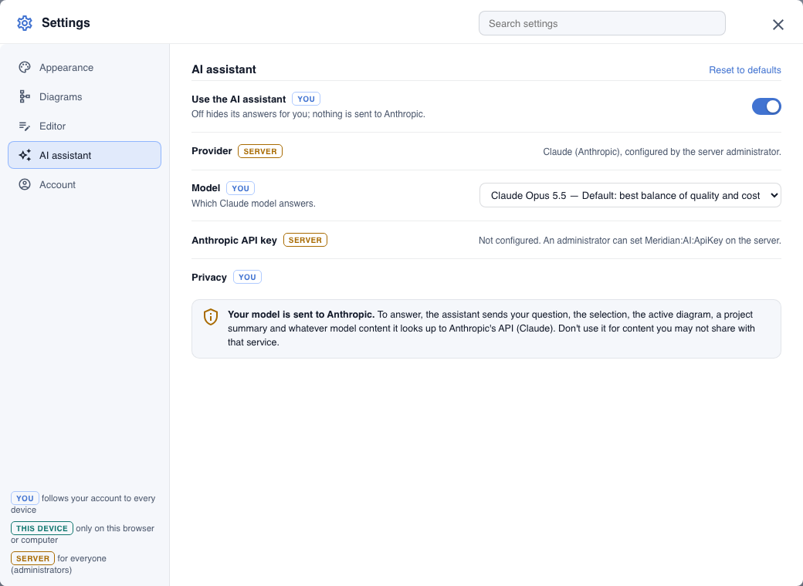
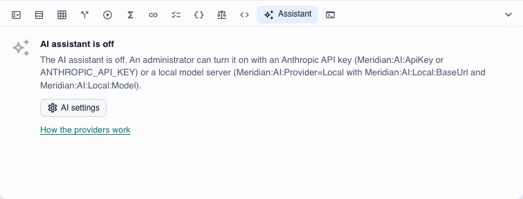
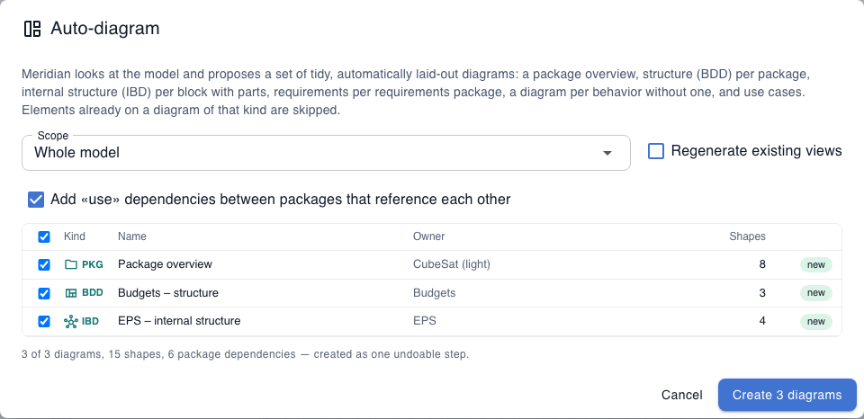
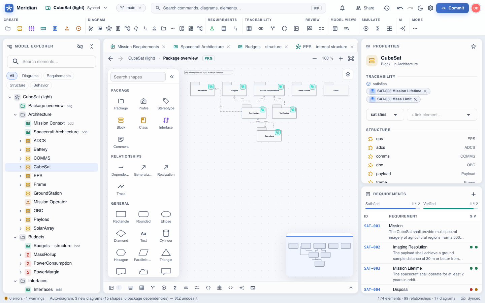

# AI assistant

The assistant answers questions about the open model, reviews it and proposes changes. You see every proposed change as
a list of additions, edits and removals, and you choose what to apply. The assistant never edits the model on its own.

Open it with the **AI ▸ Assistant** ribbon button, the **Assistant** dock tab, or ⌘K "Ask the assistant".

## Pick a provider

The assistant can run on three providers. The panel header always shows which one and which model is answering.

| Provider | What you need | Where model content goes |
| --- | --- | --- |
| **Claude (Anthropic)** | an Anthropic API key | Anthropic |
| **Local / OpenAI-compatible** | Ollama, LM Studio, the llama.cpp server, vLLM, LocalAI or another server with an OpenAI-compatible `/v1` endpoint | your model server only |
| **Claude Code (your login)** | Claude Code installed and signed in, on the computer that runs Meridian (desktop app or local mode) | Anthropic, through your own Claude Code login |

<picture>
  <source media="(prefers-color-scheme: dark)" srcset="../images/settings-ai-dark.png">
  
</picture>

### In the desktop app

Open **Settings ▸ AI assistant** (⌘,) and choose a **Provider**:

- **Claude (Anthropic)**: paste your API key (get one at <https://console.anthropic.com>). It is stored encrypted on
  this computer and never shown again.
- **Local / OpenAI-compatible**: click **Ollama** or **LM Studio** to fill in the address, **Find models**, pick one
  and **Save**. **Test connection** checks that the server answers, that the model is installed and whether it can
  call tools.
- **Claude Code (your login)**: offered when the `claude` command is found. **Check installation** runs
  `claude --version` and `claude auth status`, which use no tokens. Usage counts against your own Claude plan.

While the assistant is off, its panel says why and has one-click links: **Use a local model**, **Use Claude Code** or
**Use Claude with an API key** switch the provider and open Settings to finish. **How the providers work** opens the
tour chapter about providers.

### On a team server

The administrator sets the provider with configuration keys (`Meridian:AI:ApiKey`, or `Meridian:AI:Provider=Local`
with `Meridian:AI:Local:BaseUrl` and `Meridian:AI:Local:Model`). Users can't enter keys or change the provider in the
browser; **AI settings** shows what the server uses. Claude Code is never used on a server.
`Meridian:AI:Enabled=false` turns the assistant off for everyone. See
[Administration](administration.md) and
[docs/AI.md](https://github.com/finepointcgi/meridian/blob/main/docs/AI.md) for every key.

<picture>
  <source media="(prefers-color-scheme: dark)" srcset="../images/assistant-off-dark.png">
  
</picture>

### Local models

Ollama:

1. Install Ollama from <https://ollama.com> and start it.
2. Pull a model that can call tools, for example `ollama pull qwen2.5:14b`.
3. Give it a bigger context window, for example `OLLAMA_CONTEXT_LENGTH=32768 ollama serve`, and set the same
   **Context window** in Meridian.
4. In **Settings ▸ AI assistant** choose **Local / OpenAI-compatible**, click **Ollama**, **Find models**, pick the
   model and **Save**.

LM Studio: download a model, start the local server (*Developer ▸ Start server*), then choose
**Local / OpenAI-compatible**, click **LM Studio**, **Find models** and **Save**.

Quality varies a lot between local models. Models known to handle tools reasonably well include Qwen 2.5 / Qwen 3
Instruct (14B and up), Llama 3.1 / 3.3 Instruct (70B does much better than 8B) and Mistral Small. Small models answer
questions fine but make mistakes in long tasks such as *Diagram my model*. Every proposal still goes through the review
card, so nothing reaches your model unchecked. A model without tool calling still works through a text protocol that
Meridian checks before anything runs.

## Privacy

With Claude or Claude Code, using the assistant **sends model content to Anthropic**. With a local model it goes to
your model server instead. Each question includes a project summary, the active diagram's element names, the selection,
and whatever the assistant looks up while answering.

The first time you open the assistant it shows a notice and sends nothing until you accept. API keys stay on the
server and are never sent to the browser. Meridian does not log prompts or answers, and conversations are kept in
memory only (**New chat** clears one).

## Using it

- **Chat.** Answers stream in. Elements named in an answer show as chips: click one to select it. **Stop** cancels.
- **Proposed changes.** Changes arrive as a card listing each added (+), changed (~) and removed (−) item. Accept or
  reject each one, then **Apply**: it is one undo step. **Discard** drops the card. Only people who can edit the project can apply.
- **Quick actions** above the chat:
  - *Generate requirements from text…*: paste a specification, get "shall" requirements with ids, rationale and
    verification methods.
  - *Suggest trace links*: satisfy, verify and derive links for uncovered requirements, each with a confidence and a
    reason.
  - *Review this model*: a checklist of gaps such as unverified requirements, orphan blocks, vague wording and missing
    units.
  - *Diagram from description…*: describe a system or process and get a block definition, internal block, activity or
    package diagram.
  - *Diagram my model*: the assistant picks the views that tell the story and names them. You accept or reject each
    diagram; Meridian does the layout.

## Auto-diagram without AI

**Diagram ▸ Auto-diagram** in the ribbon (or ⌘K "Diagram the whole model", or right-click a package ▸
**Auto-diagram this package…**) needs no AI. It plans a package overview, a block definition diagram per package, an
internal block diagram per block with parts, requirement diagrams, use case diagrams and a diagram for each activity or
state machine that has none. Tick the views you want and **Create**. Elements already shown on a diagram of that kind
are skipped unless you tick **Regenerate existing views**.

<picture>
  <source media="(prefers-color-scheme: dark)" srcset="../images/auto-diagram-dialog-dark.png">
  
</picture>

<picture>
  <source media="(prefers-color-scheme: dark)" srcset="../images/auto-diagram-result-dark.png">
  
</picture>

## AI in other places

- **Create from… ▸ Fill in with AI** writes a use case's steps or names a sequence's messages. See
  [Creating diagrams from diagrams](derivation.md#fill-in-with-ai-optional).
- **Generate SDD…** can draft a narrative for each section, which you review before it goes in the document. See
  [Reports and documents](document-generation.md).
