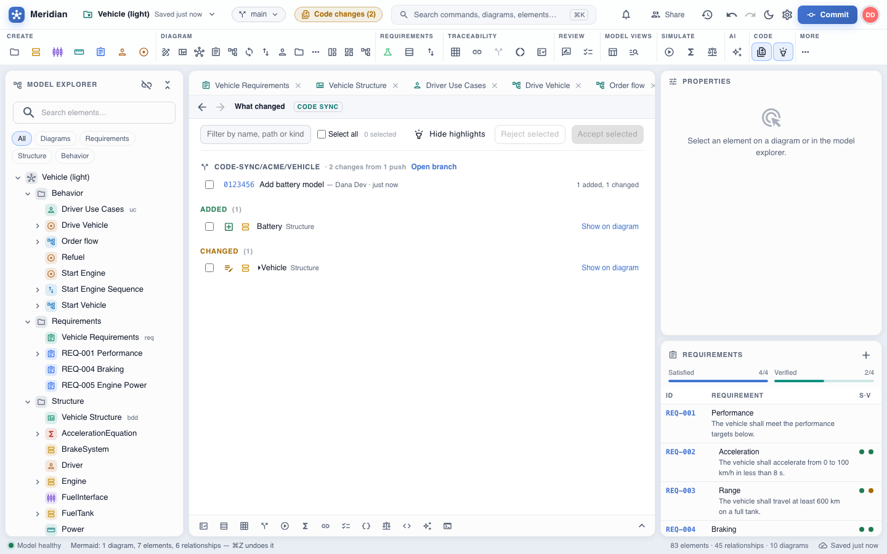
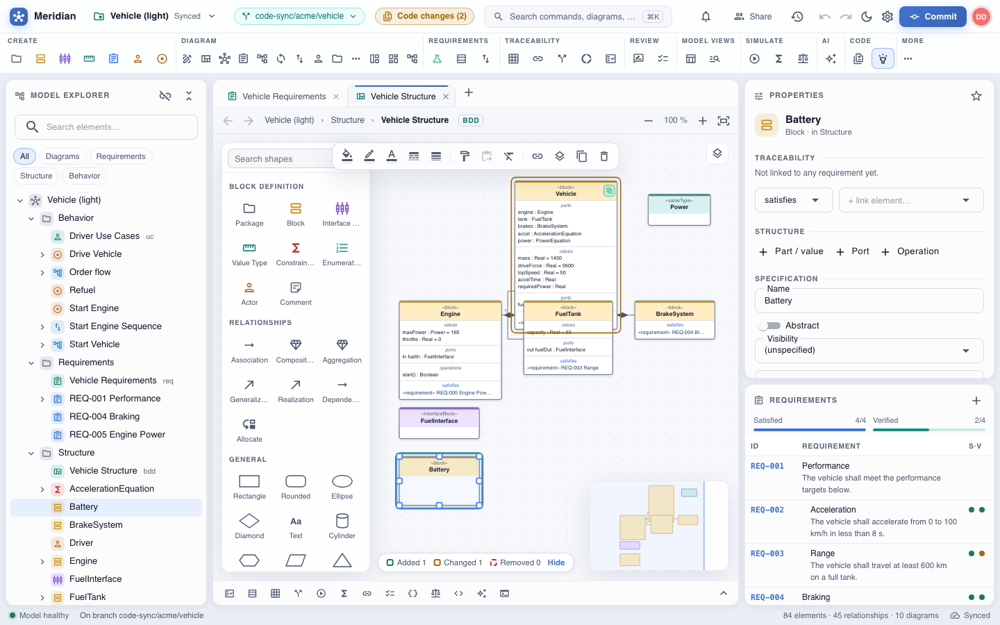

# Code sync

Connect a GitHub or GitLab repository and Meridian keeps a part of the model in step with the code. The first sync
imports the code straight into `main`, so you see it at once. After that, each push updates a **review branch** of the
model, never `main`. You look at what changed, then accept all or some of it into `main`.

<picture>
  <source media="(prefers-color-scheme: dark)" srcset="../images/code-changes-dark.png">
  
</picture>

## Connect a repository

1. Open the project menu ▸ **Integrations (issue trackers, webhooks, code)…** ▸ **Code repositories**. In an empty
   **Code changes** tab, **Connect a repository** opens the same place, and so does ⌘K "Connect a code repository".
2. Click **Add repository** and choose **GitHub** or **GitLab**.
3. Fill in the owner and repository (GitHub) or the project path (GitLab), the **Branch** to follow, and an
   **Access token**:
   - GitHub: a token that can read contents and write commit statuses.
   - GitLab: `read_repository`, plus `api` if Meridian should post commit statuses.
4. Optional:
   - **Folders to include** (for example `src/Domain, src/Shared`). Empty means the whole repository.
   - **Model package**: the package the code goes into. By default it is named after the repository.
   - **Sync on every push to the branch** and **Post a commit status (meridian/model)**.
   - **Review the first import too** (off by default): the first sync waits for review like later ones, instead of
     going straight into `main`.
   - **Deployment artifacts**: *None* (default), *One for the repository* or *One per top-level package*: artifacts that
     «manifest» the synced packages, so you can deploy the code to nodes ([deployment diagrams](deployment-diagrams.md#deploying-code)).
5. **Test connection**, then **Save**.
6. Copy the **Payload URL** and **Secret** into the repository's webhook settings, as the dialog explains. The secret is
   shown once and stored encrypted.

Only project owners can change integrations. The desktop app cannot receive webhooks: use the **sync** button next to
the repository instead. It fetches the branch head and syncs it now.

## What the code becomes

The C# reader turns the code into SysML structure:

| Code | Model |
| --- | --- |
| namespace | nested packages |
| class, struct, record | block (nested types are owned by their outer block) |
| interface | interface block |
| enum | enumeration with its literals |
| property or field typed by a scanned class | part property and a composition |
| property or field typed by a scanned interface | reference property and an association |
| other properties and fields | value properties, with the C# type as text |
| method | operation (overloads are merged) |
| base class, implemented interface | generalization, realization |

Generated code (`obj/`, `bin/`, `*.g.cs`, `*.Designer.cs` and files marked `<auto-generated>`) is skipped. Only public
members are read by default. Types from NuGet packages keep their names but get no
relationships.

Meridian matches elements by their code symbol, so a second sync changes only what changed in the code. Your
stereotypes, tagged values, hand-made elements and hand-made relationships are left alone. Running the same code twice
changes nothing.

## Activity and sequence diagrams from code

Code sync also reads method bodies and draws **behaviour** from them, in a **Behaviour** package inside each namespace's
package:

- an **activity diagram** per method: an action for each call (linked to the called operation), decisions and merges
  for `if`, `switch` and `catch`, loops as a decision with a back edge, and final nodes for `return` and `throw`
  («exception»);
- a **sequence diagram** per entry point: a lifeline for each object the method calls (named after the field, parameter or
  variable that holds it), messages for the calls, followed three levels deep, `alt` fragments for `if` / `switch`, `loop`
  fragments for loops and `break` fragments for `catch`.

Choose which methods get them with **Behaviour diagrams** in the repository's settings:

| Setting | Diagrams |
| --- | --- |
| Off | none |
| On demand | only when you ask: right-click an operation that came from code (or use the Inspector or ⌘K) and choose **Generate activity from code** or **Generate sequence from code** |
| Entry points | activities for public methods with branches, loops or many calls, sequences for controllers, endpoints, handlers, hosted services and the public API of each namespace; at most 20 activities and 10 sequences per namespace and 300 in total |
| All public methods | for every public method (at most 300 new per sync) |

New connections use *Entry points*; connections made before this existed use *On demand*. Every behaviour diagram is kept
up to date on the next sync: a changed method body updates its diagrams in place and shows in **Code changes** like any other
change, and shapes you moved stay where you put them. C# is read completely; TypeScript, Java and Python are read as well as
their hand-written readers can (see `docs/CODE-SYNC.md` for the limits).

## Submodules

If the repository uses git submodules, Meridian reads their code too. Each submodule is read at the commit the
repository pins it to, and its files appear under the submodule's folder (for example `libs/core/src/Battery.cs`), as
if they were part of the repository. Submodules inside submodules are read up to three levels deep.

- **Include git submodules** is on by default. Turn it off, or list paths under **Submodules to skip**, in the
  repository's settings. A submodule marked `update = none` in `.gitmodules` is skipped as well. **Folders to include**
  also apply inside submodules.
- **Access.** A submodule on the same server as the repository is read with the repository's token. For a submodule on
  another account or server, add a connection for that repository to the same project: Meridian uses its token.
  Public submodules on github.com, gitlab.com and bitbucket.org are read without a token. A token is only ever sent to
  its own server.
- **When one cannot be read**, the sync still runs without it, and its summary says "1 submodule not read". The
  repository's entry lists every submodule of the last sync with its commit and whether it was **fetched**,
  **skipped**, had **no access** or was **not found**.
- **Bumps.** When the repository moves a submodule to a new commit, **Code changes** shows it under **Submodules**
  (`libs/core 1a2b3c4 → 5d6e7f8`, with a **Compare** link) next to the model changes the new code brings. Accept it
  together with them.
- Elements made from submodule code have a `code.submodule` field (`libs/core@<commit>`) that tells where they came
  from. Pull request previews and the architecture checks include submodule code.

## The first import

The first sync of a repository goes straight into `main` and is committed there as *Code sync: initial import of
owner/repo at abc1234*. Anyone with `main` open sees the code arrive. The commit status on the git host says
**Imported into main**. Each repository you connect gets its own first import.

It goes to the review branch instead when:

- **Review the first import too** is on;
- `main` already has code from this repository;
- the person the sync runs for (who pressed **sync**, or who connected the repository) can't edit `main`, or can't edit
  every package the import touches. The run's summary says so.

## Review the changes

When a push changes the model, `main` shows a banner at the top of the canvas, for example *12 code changes from
acme/vehicle are waiting for review (commit abc1234)*, with:

- **Open the code branch**: switches to the review branch with **Code changes** open;
- **Accept all into main**: accepts all of them after you confirm (owners and editors);
- **Dismiss** (×): hides the banner for you until a new push arrives.

On a phone the banner is shorter and has no accept button. If `main` is still (nearly) empty, the empty-project hint
says **Your code is on the review branch**, with the same buttons.

The title bar also shows **Code changes (N)**. Click it, or use the **Code ▸ Changes** ribbon button, or ⌘K "Code
changes".

**Code changes** lists, per review branch:

- the pushes waiting for review: commit, message, author and a summary. Tick a push to select all of its changes;
- the changes grouped into **Added**, **Changed** and **Removed**. A changed element opens to show each field before and
  after;
- **Show on diagram**, which opens a diagram with the element selected (on the review branch if it only exists there).

Tick changes, or **Select all**, then:

- **Accept selected** merges them into `main`. Changes you did not tick stay on the review branch for later. If someone
  changed the same thing on `main`, the merge dialog asks which side to keep.
- **Reject selected** puts those elements on the review branch back to `main`'s version. The next push that still has
  them brings them back, because the code is the source of truth.

Only owners and editors can accept or reject. Viewers can read the review.

## Highlights on diagrams

On a review branch, diagrams show what the code changed:

| Change | Drawn as |
| --- | --- |
| Added | green outline |
| Changed | amber outline |
| Removed | a faded, dashed ghost where `main` has it |

<picture>
  <source media="(prefers-color-scheme: dark)" srcset="../images/code-highlights-dark.png">
  
</picture>

Turn the highlights on or off with the legend on the canvas, **Code ▸ Highlight** in the ribbon or ⌘K "Highlight code
changes". On `main`, the same switch outlines what a pending review would change.

New elements are added to the diagrams they belong on, in free space below what is there. Shapes you placed never move.
New namespaces and blocks get their own diagrams from [Auto-diagram](ai-assistant.md#auto-diagram-without-ai).

## For administrators

The full reference (mapping rules, limits, the sync-run records and the hooks for integrators) is in
[docs/CODE-SYNC.md](https://github.com/finepointcgi/meridian/blob/main/docs/CODE-SYNC.md). Webhook and token settings
for the server are in [Integrations](integrations.md).
