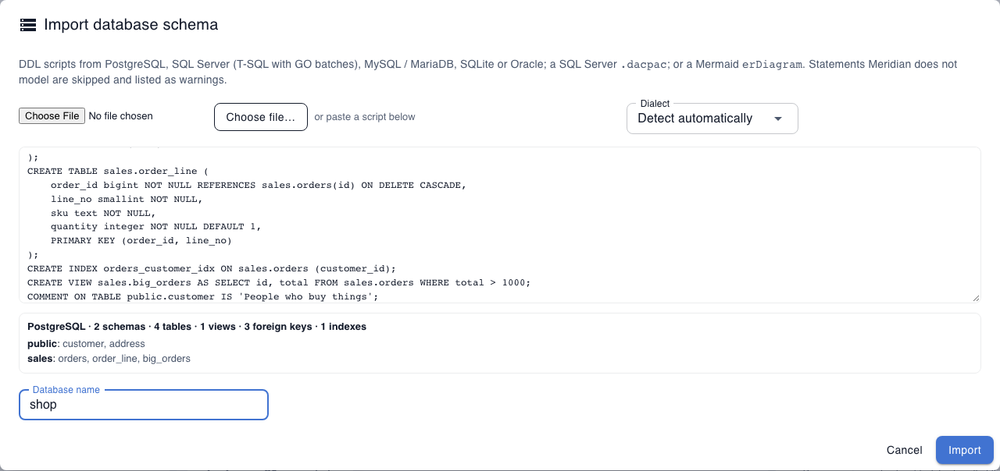
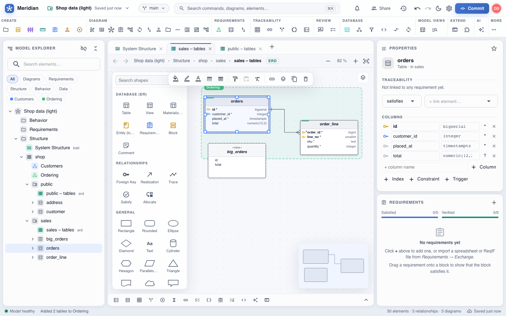
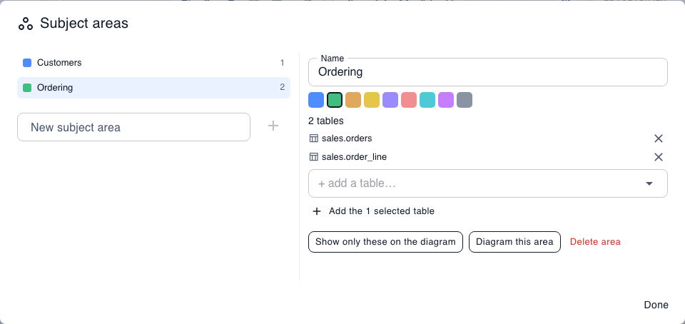
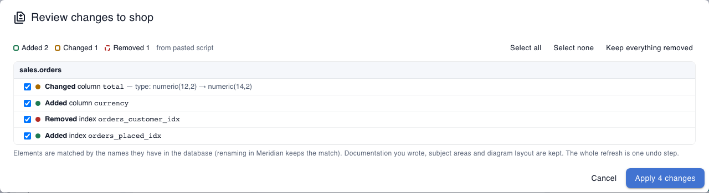
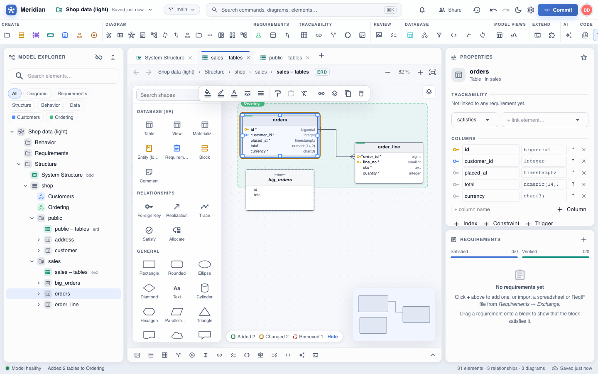
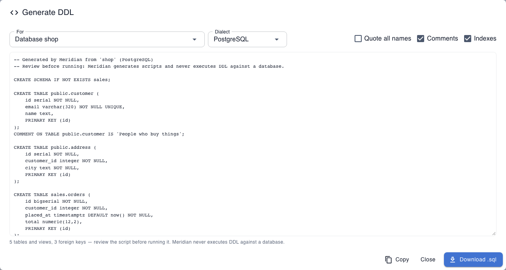

# Database modelling

Meridian models relational databases next to your system model: databases and schemas, tables and views, columns,
keys, indexes and constraints, sequences and enum types, and **subject areas** that group tables across schemas.
You can import an existing schema (from a script, a SQL Server `.dacpac` or a live database), keep it in step with the
database, design changes on crow's-foot diagrams, and generate DDL and migration scripts.

> Meridian never runs DDL against a database. It reads catalogs (read-only) and writes scripts that you review and run
> with your own tools.

## Import a schema

Project menu ▸ **Import ▸ Database schema (DDL / .dacpac)…** (or ⌘K "Import database schema"). Choose a file or paste
a script; Meridian detects the dialect (or pick it) and shows what it found before anything changes.

<picture>
  <source media="(prefers-color-scheme: dark)" srcset="../images/database-import-dark.png">
  
</picture>

| Source | Notes |
| --- | --- |
| PostgreSQL DDL (`pg_dump --schema-only`) | schemas, tables, views, materialized views, enum and domain types, sequences, indexes (partial, expression, GIN…), functions, triggers, `COMMENT ON` |
| SQL Server (T-SQL) | `GO` batches, `[brackets]`, IDENTITY and computed columns, default constraints, `MS_Description` comments |
| MySQL / MariaDB | backticks, `AUTO_INCREMENT`, `KEY` / `UNIQUE KEY`, inline `COMMENT`s, `DELIMITER` blocks |
| SQLite | inline keys, `AUTOINCREMENT`, typeless columns, `WITHOUT ROWID` |
| Oracle | `VARCHAR2` / `NUMBER`, identity columns, `/`-terminated PL/SQL, `ALTER SESSION SET CURRENT_SCHEMA` |
| SQL Server `.dacpac` | everything in its `model.xml` (extract one with `sqlpackage /Action:Extract`) |
| Mermaid `erDiagram` | entities, attributes with `PK` / `FK` / `UK`, relationships become foreign keys |

Statements Meridian does not model (grants, policies, extensions…) are skipped and listed as warnings. The import
creates a database with its schemas and **a diagram per schema**, as one undo step. **Import into this project…**
with a `.sql`, `.ddl` or `.dacpac` file imports directly, and the desktop app opens such files as new projects.

### From a live database

Project menu ▸ **Connect to a database…** opens Integrations ▸ **Databases**. Add a connection (PostgreSQL, SQL Server /
Azure SQL, MySQL / MariaDB or Oracle; SQLite files in the desktop app), test it, then **Import**. The connection string
is stored encrypted and never shown again. **Use a read-only account**: Meridian only reads the catalog (`pg_catalog`,
`sys.*`, `information_schema`, `ALL_*`), in read-only transactions where the database has them. Procedures, functions
and triggers come with their bodies.

| Database | Example connection string |
| --- | --- |
| PostgreSQL | `Host=db.example.com;Database=shop;Username=reader;Password=…;SSL Mode=Require` |
| SQL Server | `Server=db.example.com,1433;Database=shop;User ID=reader;Password=…;Encrypt=True` |
| MySQL / MariaDB | `Server=db.example.com;Database=shop;User ID=reader;Password=…` |
| Oracle | `Data Source=db.example.com:1521/FREEPDB1;User Id=reader;Password=…` (the user's own schema unless you list schemas) |

On a team server only server administrators can add connections, and hosts on private networks are refused unless
an administrator allows them (`Meridian:Integrations:AllowPrivateNetworks`). Connections the server can't check —
SQL Server named pipes or LocalDB, Oracle TNS aliases, several hosts — are refused there; the desktop app connects to
anything. SQL Server signs in with SQL logins (or an access token); Windows authentication over named pipes is not
available.

## Database diagrams

<picture>
  <source media="(prefers-color-scheme: dark)" srcset="../images/database-diagram-dark.png">
  
</picture>

Tables list their columns with a **gold key** on primary-key columns, a **blue key** on foreign-key columns, `UQ` on
unique ones and `*` after mandatory columns; the type is on the right. Views have a dashed outline. Foreign keys use
crow's-foot ends — many at the referencing table, one (bar) or zero-or-one (circle, when the column is nullable) at
the referenced table — and run from column to column when the tables sit side by side.

* Ribbon **Database ▸ Subject areas ▸ Columns**: show all columns, **keys only**, or none.
* **New table** adds a table to the selected schema and the open diagram. The shapes panel also has views,
  materialized views and logical **entities** (a table *realizes* the entity it implements).
* Draw a **Foreign Key** from a **column row** to another table: that column references the other table's primary
  key (drop it on a column row to pick the referenced column). Without a column, Meridian adds `<table>_id` with the
  key's type.
* **Auto-diagram** (or the database's context menu ▸ *Diagram each schema and subject area*) lays out one diagram per
  schema and per subject area.

## Edit tables

Select a table: the inspector's **Columns** list edits names and types in place, the key icon makes a column part of
the primary key in one click, `*` / `?` toggles NOT NULL, and **+ Column** adds one (type a name and press Enter).
Add indexes, unique or check constraints and triggers below it. Columns have identity, generated expression and
collation fields; foreign keys their *on delete* / *on update* actions; the database its dialect and naming
convention.

Procedures, functions and triggers keep their **body** exactly as the script or the database had it — select one to
see and edit it in a monospace field (with the routine's parameters, return type, language and options such as
`STABLE` or `DETERMINISTIC`). Bodies are generated in DDL and migration scripts for the dialect they were written in.

Renaming a column updates the foreign keys, indexes and constraints that use it. **Validate** (F7) checks tables
without a primary key, foreign keys whose types don't match, duplicate names, reserved words of the database's
dialect, the naming convention (snake_case, PascalCase or camelCase) and tables in no subject area.

Tables and columns take part in traceability like any element: link them to requirements with «satisfy» or «trace»,
and allocate blocks or data items to them.

## Subject areas

A subject area groups tables by topic, independently of schemas — a table can be in several. Select tables and use
ribbon **Database ▸ Add to subject area**, or **Subject areas ▸ Subject areas…** to create, rename, colour and fill them.

<picture>
  <source media="(prefers-color-scheme: dark)" srcset="../images/database-groups-dark.png">
  
</picture>

Areas appear as coloured frames on database diagrams. **Subject areas ▸ Show on this diagram** filters a diagram to one
area, the model explorer has a chip per area, and DDL and the data dictionary can be generated for an area. Areas
are packages, so **package permissions** set on an area apply to its tables.

## Refresh from the database

When the database changes, **Refresh…** (ribbon, or the database's context menu) reads it again through its
connection — or asks for the new script — and shows what is different: added, changed and removed tables, columns,
keys, indexes and more. Untick anything you want to keep as it is.

<picture>
  <source media="(prefers-color-scheme: dark)" srcset="../images/database-review-dark.png">
  
</picture>

Applying is one undo step, and the diagrams highlight what changed (as for code changes). Elements are matched by
the names they have in the database, so tables renamed in Meridian still match. Documentation you wrote, subject
areas and diagram layout are never overwritten.

<picture>
  <source media="(prefers-color-scheme: dark)" srcset="../images/database-refreshed-dark.png">
  
</picture>

## Generate DDL and migration scripts

**Generate DDL…** writes the CREATE script for a database, schema, subject area or the selected tables, for
PostgreSQL, SQL Server, MySQL, SQLite or Oracle: schemas and types first, tables in dependency order, indexes, then
foreign keys, views, comments, routines and triggers (with each dialect's batch syntax: `GO`, `DELIMITER $$`, `/`).
Copy it or download a `.sql` file.

<picture>
  <source media="(prefers-color-scheme: dark)" srcset="../images/database-ddl-dark.png">
  
</picture>

**Migration script…** writes the ALTER statements that turn what a database has now into the model: choose an empty
database, a committed version, a baseline, another branch, a live connection or a pasted script as the starting
point. Steps that can lose data or fail on existing rows — drops, type changes, `SET NOT NULL` — are marked
`-- WARNING:` and listed above the script. Changed procedures, functions and triggers are replaced
(`CREATE OR REPLACE`, `CREATE OR ALTER`, or drop and create, per dialect).

**Renames keep your data.** Against a committed version, a baseline or another branch, Meridian knows which table or
column you renamed and writes a rename (`ALTER TABLE … RENAME COLUMN`, `sp_rename` …) instead of dropping and adding
it. A live database or a pasted script can't tell, so the dialog lists **Possible renames** — a column that disappeared
and one of the same type that appeared, a table with mostly the same columns under a new name — each with a check
box: tick the ones that really are renames.

Constraints the database named itself (a foreign key declared without a name, SQL Server defaults) are dropped by a
short script that looks the generated name up in the database's catalog, so the script runs as is.

## Data dictionary

⌘K **Data dictionary (CSV)** or **(Excel)** exports every column with its table, type, keys, references, default,
comment and subject areas. For a formatted document, **Generate ▸ Report** offers the **Data Dictionary** template
(PDF, Word or HTML) with the tables, their columns and the database diagrams.

See also: [Import and export](import-export.md), [Integrations](integrations.md), and `docs/DATABASE.md` in the
repository for the full reference.
