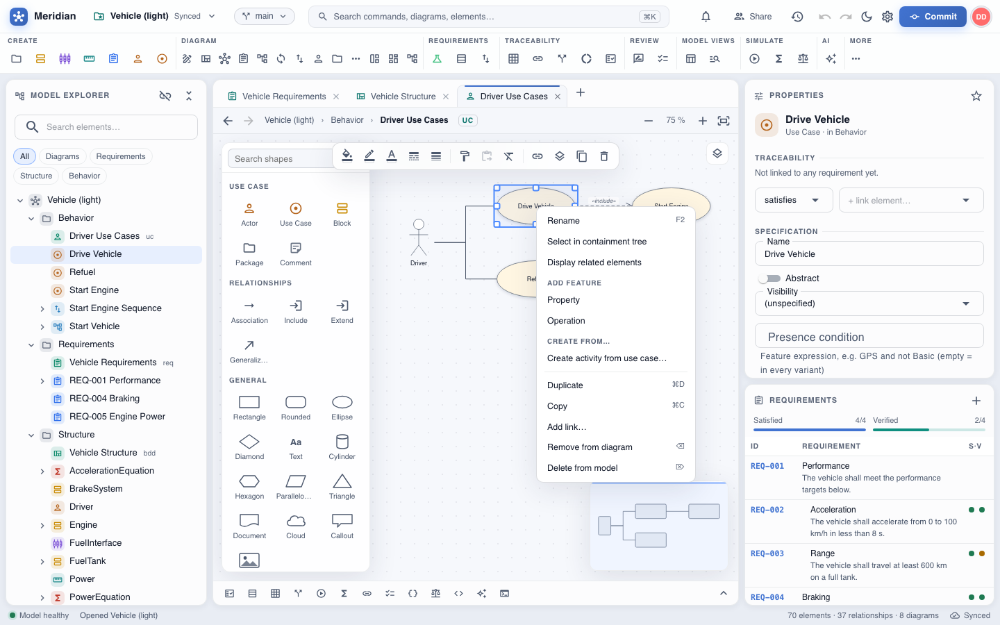
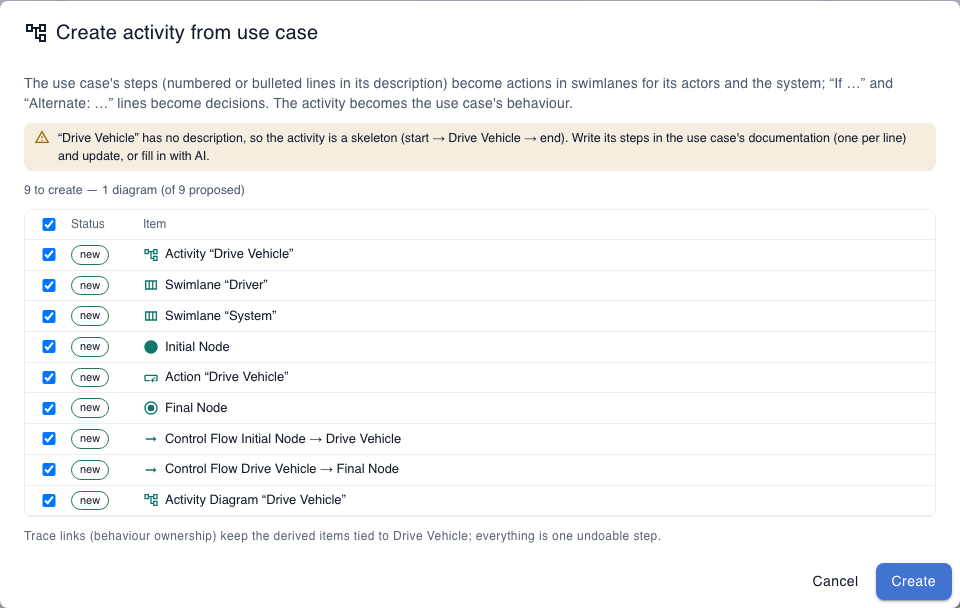
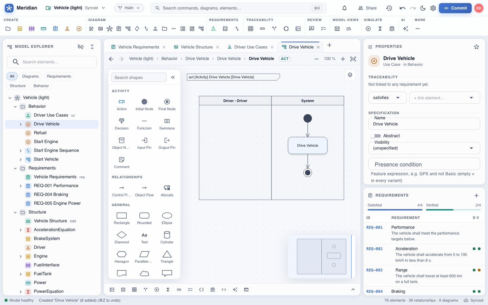

# Creating diagrams from diagrams

Meridian can make the next view of the MBSE chain from the one you have, the way a systems engineer works down it:

**Requirements → Use case → Activity → Sequence → BDD / IBD (→ State machine)**

Each step follows fixed rules, so it works without AI and gives the same result every time. You see the plan first,
untick what you don't want, and everything goes in as **one undo step**. Every derived element remembers its source, so
a derived diagram knows when the source changed and can be updated without losing your own work.

## Where to find it

- **Right-click** a requirements package, requirement, use case, activity, interaction or block, in the model explorer
  or on a diagram. The **Create from…** section of the menu lists only what applies. Right-clicking an action, a
  swimlane or the empty canvas offers the derivations of the diagram's activity or interaction.
- **Ribbon ▸ Diagram ▸ Create from…**: the derivations of the selection, or of the active diagram.
- **⌘K**: "Create activity from use case (Drive Vehicle)", "Create sequence from activity (…)" and so on, plus
  "Update “…” from source" when the active diagram is out of date.
- **Inspector ▸ Derivation chain**: shows where the selection sits in the chain, for example
  *Requirements → Use case → **Activity** → Sequence → IBD*. Each existing link opens its diagram, and the first
  missing one has **Create next…**.

<picture>
  <source media="(prefers-color-scheme: dark)" srcset="../images/derive-menu-dark.png">
  
</picture>

## Check the plan

The dialog lists every item it would create, with a checkbox and a status (**new**, **change** or **remove**), and
warnings such as "no description, so the activity is a skeleton". Untick an item and everything that depends on it
goes too: unticking an action also drops the flows to it. **Create** applies what is ticked. New diagrams open as tabs.

<picture>
  <source media="(prefers-color-scheme: dark)" srcset="../images/derive-dialog-dark.png">
  
</picture>

## What each step makes

| From | Creates | How | Trace kept |
| --- | --- | --- | --- |
| Requirements | a use case diagram in a new "*Package* use cases" package | each functional requirement's "shall …" phrase names a use case ("shall allow the operator to schedule imaging passes" → **Schedule Imaging Passes**); actors come from a `stakeholder` attribute, from "allow the *X* to …", or from actors the text names | «refine» |
| Use case | an activity owned by the use case, with its diagram | the description's numbered or bulleted lines (or sentences) become actions; a step that starts with an actor's name goes in that actor's swimlane, the rest in **System**; "If *X*, *Y*" becomes a decision; "Alternate: *X* - *Y*" branches off | the activity is the use case's behaviour |
| Activity | an interaction and a sequence diagram | one lifeline per swimlane, one message per hand-over between swimlanes; decisions become **alt** with one guarded operand per branch, forks **par** with one operand per branch, and loops **loop** | «allocate» action → block |
| Sequence | a BDD and an IBD | a block per lifeline, a context block with one part each, an operation per message received, ports and connectors between parts that talk | «trace» message → operation |
| Sequence or activity | a state machine for a block you pick | the events the block receives become states in order: a call it answers is a "Handling *event*" state that returns where it came from, other events lead to "After *event*"; alternatives become guarded transitions, through a choice when they start with the same event (approximate) | owned by the block |
| Blocks / requirements | proposals only | «satisfy» where a block's name appears in a requirement, and a "Verify *requirement*" test case with «verify» for each unverified requirement | «satisfy», «verify» |

<picture>
  <source media="(prefers-color-scheme: dark)" srcset="../images/derive-activity-dark.png">
  
</picture>

> [!TIP]
> Write a use case's steps in its documentation, one per line, before you create the activity. Start a line with an
> actor's name ("Driver presses start") to put it in that actor's swimlane.

## Update from source

When a source changes (say, you reword a use case's steps), its derived diagrams show an amber **Source changed** badge
and a dot on the tab. **Update from source…** shows the diagram as it would look after the update, with the same
highlights as [code sync](code-sync.md): green for added, amber for changed, a dashed ghost for removed. Tick what you
want and **Accept**, or **Dismiss** to keep the diagram as it is and clear the badge.

An update never:

- touches elements, relationships or shapes you added yourself;
- moves shapes that are already on the diagram;
- removes or overwrites an item you edited since it was derived without asking. Those are listed but not ticked.

Numbered steps keep their number as their key: rewording step 2 is a **change**, deleting step 4 a **remove**, a new
step 5 an **add**.

## Fill in with AI (optional)

When the [AI assistant](ai-assistant.md) is on, the dialog has a **Fill in with AI** switch for the two places where
rules run out: writing a use case's steps from free text, and naming the messages of a sequence (`requestStart`
rather than `checksTheBrakePedal`). The answer is shown in the same preview, marked "written by AI", before anything
is created.

The full reference, with the stored `derive.*` fields and how updates are matched, is
[docs/DERIVATION.md](https://github.com/finepointcgi/meridian/blob/main/docs/DERIVATION.md).
