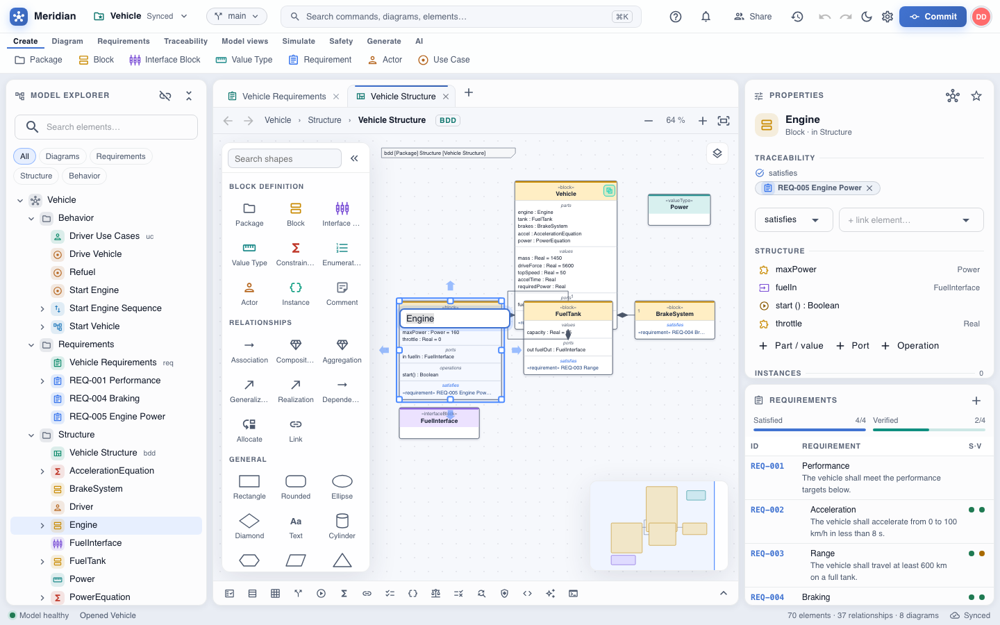

# Drawing basics

Every diagram in Meridian is drawn on the same canvas, whether it is a SysML block definition diagram or a free
whiteboard. Shapes on a modeling diagram are views of model elements: renaming a block on one diagram renames it
everywhere, and deleting it from the model removes it from every diagram.

<picture>
  <source media="(prefers-color-scheme: dark)" srcset="../images/drawing-bdd-dark.png">
  
</picture>

## Adding shapes

- **Shapes panel.** **Show shapes** opens a searchable panel with the element kinds that fit the diagram (for example
  Block, Interface Block, Value Type, Constraint Block on a block definition diagram) and its relationship tools.
  Click a tile and then click the canvas, or drag a tile onto the canvas. Hold **Shift** while placing to keep the tool
  active for several shapes. **Esc** returns to the select tool.
- **General shapes** are offered on every diagram: rectangle, rounded rectangle, ellipse, diamond, text, cylinder,
  hexagon, parallelogram, triangle, document, cloud and callout, plus plain lines (arrow, line, dashed arrow, dashed,
  bidirectional, dotted). They are drawing-only shapes, handy for annotations.
- **Double-click empty canvas** to open a quick-add search at that point: type part of a kind name and press **Enter**.
- **From the model explorer**, drag existing elements onto the diagram to show them. Relationships to elements that
  are already shown are drawn automatically.
- **From the ribbon**, the *Create* group adds a package, block, interface block, value type, requirement, actor or
  use case to the selection and shows it on the active diagram when it fits there.

## Hover arrows

Hover over a shape to see four blue arrows. **Click** an arrow to add a connected shape of a sensible kind next to it;
**drag** an arrow onto another shape to connect the two. On modeling diagrams Meridian only offers relationships the
metamodel allows (for example *satisfy* from a design element to a requirement), and it rejects invalid ends with a
message in the status bar.

## Labels and editing

- Select a shape and **start typing** to replace its label (as in draw.io), or press **Enter** or **F2** to edit it.
- **Double-click** a shape to rename it. Double-click a path to add a bend point.
- **Enter** commits the edit and **Esc** cancels it. In comments and free shapes, **Shift+Enter** adds a line break.

## Selecting, moving and resizing

- Click to select, **Shift**-click to add to the selection, drag on empty canvas to select a rectangle, **⌘A** /
  **Ctrl+A** selects everything.
- Drag to move; alignment guides appear when edges or centres line up. Arrow keys nudge the selection by one grid step,
  **Shift**+arrow by five.
- Drag the handles to resize. Pictures keep their aspect ratio unless you hold **Shift**.
- With several shapes selected, the selection toolbar aligns them (left, centres, right, top, middles, bottom),
  distributes three or more horizontally or vertically, and makes them the same width or height.
- **⌘D** / **Ctrl+D** duplicates, **⌘C** / **⌘V** copies and pastes.

## Removing things

| Key | Effect |
| --- | --- |
| **Backspace** | Removes the selection from this diagram only. The elements stay in the model. |
| **Delete** (or **⌘/Ctrl+Backspace**) | Deletes the selection from the model, with every relationship and diagram view of it. |

Both are undoable with **⌘Z** / **Ctrl+Z**.

## The format bar

With shapes or paths selected, the format bar sets:

- **fill**, **line** and **text** colour, from swatches or *Custom…*;
- **line width** for paths and outlines;
- **Copy format** / **Paste format** (the format painter) to reuse a look on other shapes;
- **Reset to default look**.

Colours are stored per diagram: the same block can be highlighted on one diagram and plain on another. Stereotypes can
also carry a colour (see [Profiles](diagrams.md#profiles-and-stereotypes)), and a diagram can show a legend of the
colours and kinds it uses (*Show legend* in the inspector when the diagram is selected).

## Layers

The **Layers** button on the diagram toolbar opens the layers panel. Each diagram has a *Default* layer; you can add,
rename and delete layers (shapes on a deleted layer move to *Default*), change their order with *Bring forward* /
*Send backward*, hide a layer, or lock it so its shapes cannot be selected or moved. **Move selection to** puts the
selected shapes on a layer. Hidden layers are left out of SVG and PNG exports.

## Pictures

Drop an image file onto the canvas, paste one from the clipboard, or use the *Image* tile in the shapes panel. Images
are downscaled to at most 2 MB and stored in the model, so they travel with the project, its versions and exports.

## Links

Right-click a shape and choose **Add link…** to attach a web address (`http`, `https` or `mailto`) or a link to another
model element or diagram. A small link icon appears on the shape. **⌘-click** / **Ctrl-click** the shape or its icon
to follow the link (web links open in a new tab, element links select the element or open the diagram).

## Navigating

- **⌘/Ctrl + mouse wheel** zooms, the wheel or a middle-button drag pans, and holding **Space** while dragging pans too.
- The breadcrumbs above the diagram show its owner chain; click one to select it or open its diagram.
- **Back** and **Forward** move through the diagrams you opened.
- The minimap shows where you are on large diagrams; click it to jump.
- **Fit** (or *Zoom to fit* in the canvas menu) shows the whole diagram.

## The canvas menu

Right-click the canvas or a shape for context actions. Depending on what is selected these include *Rename*,
*Duplicate*, *Remove from diagram*, *Delete from model*, *Select in containment tree*, *Display related elements*,
*Add feature* (properties, ports, operations on blocks), *Show nested parts* and *Show ports on border* (parts on
internal block and parametric diagrams), *Add input pin* / *Add output pin* (actions), *Allocate actions to swimlanes* (activity diagrams), *Straighten path*, *Arrange*, *Add link…*,
*Copy diagram as image* and *Export as PNG… / SVG*.

## Selecting many

Shift-click or ⌘-click to add shapes and connectors to the selection, drag a box on empty canvas, or press ⌘A. The
Inspector then edits them all at once, and **Link to…** links them all to one element. Lines you draw pick their
relationship type for you. See [Multi-select and bulk editing](multi-select.md).

## Automatic layout

**Arrange** (ribbon *Diagram* group, or the canvas menu) lays the diagram out in layers that follow the relationship
direction: general above specific, wholes above parts, requirements above the elements that satisfy or verify them.
It is one undo step, so you can always go back.

**Auto-diagram** (ribbon *Diagram* group) goes further and draws new diagrams for what is already in the model: a
package overview, structure, internal structure, requirement and behaviour views. See
[AI assistant](ai-assistant.md#auto-diagram-without-ai); it needs no AI.

## Diagram templates

**+** on the tab strip → **From template…** creates a ready-made diagram in the selected package: flowchart, mind map,
BPMN process, ER diagram, requirement tree, system context or ArchiMate layered view.
