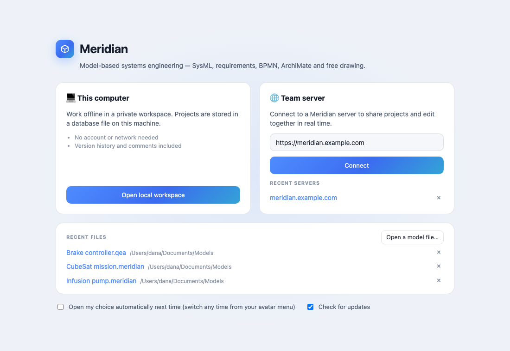
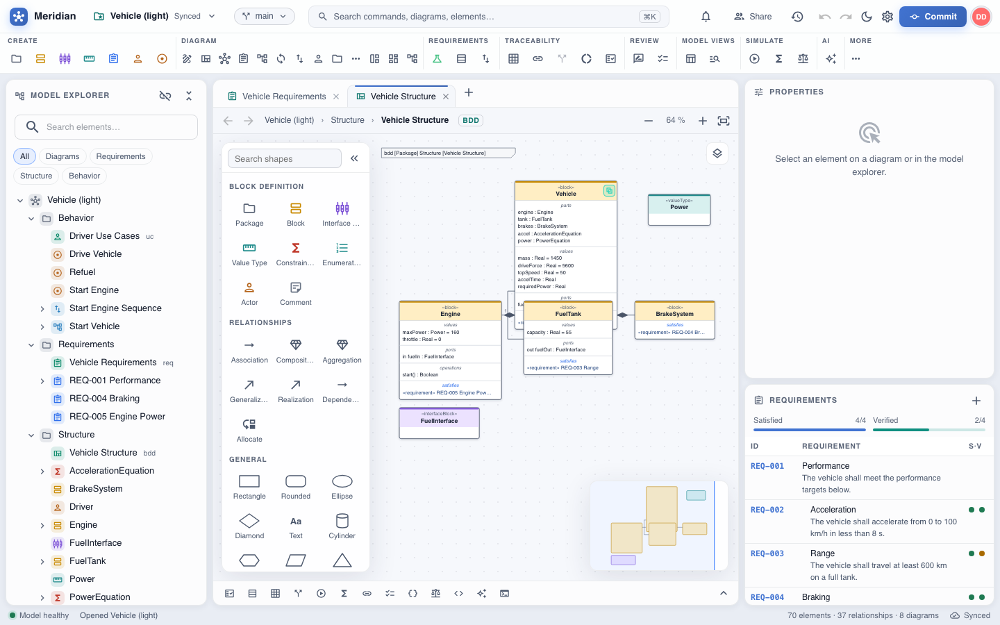

# Getting started

Meridian comes in two forms that share the same workbench:

- the **desktop app**, which works offline in a private workspace on your computer or connects to a team server, and
- the **server**, a web app that a team uses from the browser (or from the desktop app) to share projects and edit
  together in real time.

## Desktop app

### Install

Download the file for your platform from the project's *Releases* page on GitHub (or on GitLab, when your team builds Meridian there):

| Platform | File | Notes |
| --- | --- | --- |
| macOS (Apple silicon / Intel) | `Meridian-<ver>-macos-arm64.dmg` / `-macos-x64.dmg` (or `.zip`) | Drag **Meridian.app** to Applications. Builds that are not notarized need right-click → **Open** the first time. |
| Windows 10/11 x64 | `Meridian-<ver>-windows-x64-setup.exe` (or the portable `.zip`) | The installer runs per user, without administrator rights. Needs the WebView2 runtime, which Windows 11 already has. |
| Linux x64 | `.AppImage`, `.deb` or `.tar.gz` | Needs WebKitGTK 4.1. For the `.tar.gz`, run `./install.sh` to add a menu entry and file types. |

The installers register `.meridian` (Meridian project) and `.sysml` (SysML v2 text) files, so double-clicking one opens
it in Meridian.

### Choose where to work

The start screen offers two places to work:

- **Open local workspace**: a private, offline workspace. Projects are stored in a SQLite database file in your user
  data folder (`~/Library/Application Support/Meridian`, `%APPDATA%\Meridian` or `~/.config/Meridian`). There is no
  account to create, and version history and comments still work.
- **Connect**: enter the address of a Meridian server to sign in, share projects and edit together. Servers you used
  before are listed under *Recent servers*.

The start screen also lists **Recent files** and has **Open a model file…** for `.meridian`, `.sysml`, `.xmi` and
`.qea` files. Opening a file imports it as a new project; opening an unchanged recent file again reopens the project
it created instead of importing it twice.

You can change your choice later from the avatar menu: **Switch workspace or server…**.

<picture>
  <source media="(prefers-color-scheme: dark)" srcset="../images/desktop-start-dark.png">
  
</picture>

### Updates

When **Check for updates** is on (the default), the desktop app checks its update source at most once a day (GitHub releases by default; GitLab releases, a private GitHub repository or your own Meridian server under **Settings ▸ Desktop ▸ Update source**) and shows a banner
when a newer release exists. **Install** downloads the installer for your platform, checks its SHA-256 against the
release's `SHA256SUMS.txt`, runs it and quits. Set the environment variable `MERIDIAN_NO_UPDATE_CHECK=1` to turn
checks off, for example for managed installs.

## Server

### Run with Docker

The repository's `docker-compose.yml` starts PostgreSQL and the app:

```bash
docker compose --profile app up -d --build    # → http://localhost:8180
```

### Run from source

You need the .NET 10 SDK and a PostgreSQL database (the compose file's `db` service listens on `127.0.0.1:5433`):

```bash
docker compose up -d db
cp src/Meridian.Web/appsettings.Development.example.json src/Meridian.Web/appsettings.Development.json
dotnet run --project src/Meridian.Web --urls http://localhost:5180
```

The connection string is `ConnectionStrings:Meridian`. To run a small server on a single SQLite file instead of
PostgreSQL, set `Meridian__Storage=sqlite` and `Meridian__DataPath=<folder>`.

In development, the users listed under `DevSeed` in your local `appsettings.Development.json` are created when the
server starts.

### First sign-in

The first account registered on a server becomes a server administrator (so does any username listed in
`Meridian:Admins`). See [Administration](administration.md) for users, single sign-on, backups and security settings.

## The workbench at a glance

<picture>
  <source media="(prefers-color-scheme: dark)" srcset="../images/workbench-dark.png">
  
</picture>

| Area | What it does |
| --- | --- |
| **Title bar** | The project menu (click the project name: projects, import, commit, history, branches, baselines, used projects, sharing, integrations, and an **Export ▸** submenu), the branch picker, the command palette (**⌘K** / **Ctrl+K**), the **Help (?)** menu (tour, keyboard shortcuts, this **User guide**, what's new), people editing with you, notifications, undo/redo, dark mode and **Commit**. |
| **Ribbon** | Tabs for *Create*, *Diagram*, *Requirements*, *Traceability* (with *Request review* and *Reviews*), *Model views*, *Simulate*, *Generate* (with the *Script* console and *Plugins*) and *AI*; *Database* appears when the project has a data model and *Code* when a code repository is connected. |
| **Model explorer** (left) | The containment tree. Search it, drag items onto a diagram to show them or onto another item to move them, right-click for *New element ▸*, *New diagram ▸*, *Rename*, *Delete*, *Permissions…* and more. Star items as favorites. |
| **Diagram area** (centre) | Open diagrams as tabs, with breadcrumbs, back/forward, zoom and *Fit*. **+** on the tab strip creates a diagram, also *From template…*. |
| **Dock** (bottom) | Validation, Requirements table, Traceability matrix, Impact analysis, Simulation, Parametrics, Traceability table, Reviews, Script, Variants & trades, SysML v2 text, the AI assistant and Output. Generic tables, queries, code changes, architecture checks and **verification results** open as tabs next to the diagrams (the dock's *Verification* entry opens that tab). Right-click a diagram tab for *Export ▸*, *Close* and *Close others*. |
| **Inspector** (right) | Properties, specification, stereotypes and tagged values, traceability, appearance on the current diagram, comments and linked issues for the selection. The requirements side panel sits below it. |
| **Status bar** | Model health (errors and warnings; click to validate), status messages, element counts and save state. |

The guided tour walks through these areas the first time you open Meridian. Pick any of its chapters later from the
**Help (?)** menu in the title bar ▸ **Tour…** (or ⌘K "Tour"); see [Settings and theming](settings.md#the-guided-tour).

This user guide comes with Meridian: **Help (?) ▸ User guide** (or ⌘K "User guide") opens it at `/guide` on your Meridian
server, or from the desktop app, so it works offline. "Learn more" links in empty screens and error messages open the
matching page. The sign-in page links to it too, so it can be read before signing in.

On a phone, the account menu (your initials, top right) also has **Verification results** and **Code changes**: read-only
lists of each requirement's last result (status, value against the bound, margin) and of the model changes pushed code
implies. Running a verification and accepting or rejecting code changes need a larger screen.

## Your first project

1. Open the project menu (the project name in the title bar) and choose **New project…**.
2. Pick a template. *Blank project* gives you Structure, Requirements and Behavior packages with one block definition
   diagram; the samples are complete models to explore (see [Sample projects](samples.md)).
3. Type a project name and choose **Create project**.
4. Edit. Every change is saved as you go; the status bar shows the save state.
5. **Commit** (**⌘S** / **Ctrl+S**) records a named version in the project history. See
   [Branches, merge and baselines](version-control.md).

A project with no diagrams offers one-click ways to start in the middle of the screen: **Import Mermaid**,
**Open a Cameo file**, **Start from a sample** and, once there is something to draw, **Auto-diagram**.

From here, follow [Model a drone in 20 minutes](../tutorials/drone-in-20-minutes.md) for a guided first model.
