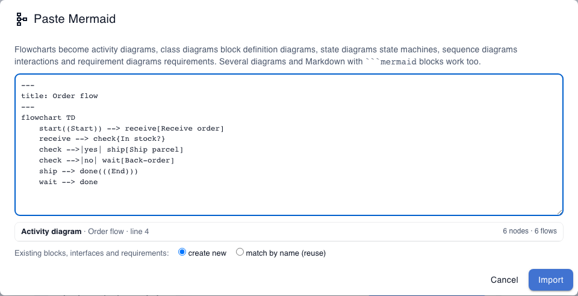
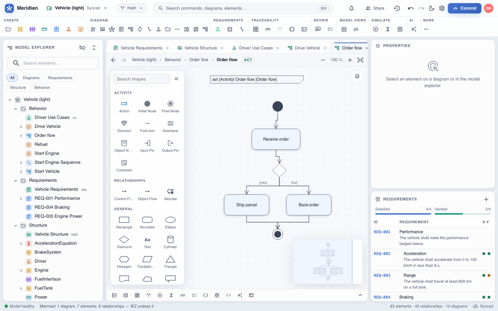

# Mermaid

Meridian reads [Mermaid](https://mermaid.js.org/) diagrams and turns them into real model elements with laid-out
diagrams. It also writes the main SysML diagram kinds back out as Mermaid. Everything runs inside Meridian; nothing is
sent anywhere.

## Bring Mermaid in

| Where | What it does |
| --- | --- |
| Project menu ▸ **Paste Mermaid…** (or ⌘K "Paste Mermaid") | Paste text, see what each diagram becomes, then **Import**. |
| Project menu ▸ **Import into this project…** with a `.mmd`, `.mermaid` or `.md` file | Opens the same dialog with the file filled in. |
| Project menu ▸ **Open a file as a new project…** with a `.mmd`, `.mermaid` or `.md` file | Makes a new project from the diagrams. |
| Drop a `.mmd`, `.mermaid` or `.md` file on the canvas | Imports it into the active diagram's package. |
| **Import Mermaid** in an empty project | Opens **Paste Mermaid…**. |

<picture>
  <source media="(prefers-color-scheme: dark)" srcset="../images/mermaid-dialog-dark.png">
  
</picture>

The preview lists each diagram with what it will create and any warnings. Choose:

- **Create new** (the default): every import makes new elements. A name used twice in one import is still one element.
- **Match by name**: existing blocks, interface blocks, value types, enumerations, actors and requirements are reused,
  and only what is missing is added. Importing the same text twice changes nothing.

The whole import is **one undo step**. New diagrams open as tabs, laid out along the Mermaid direction (`TD`, `LR`, …).
Anything Meridian could not import is listed, with its line number, in the preview, the **Output** panel and the
status bar. Broken input never stops the other diagrams.

<picture>
  <source media="(prefers-color-scheme: dark)" srcset="../images/mermaid-result-dark.png">
  
</picture>

### Mermaid from an AI chat

Any AI chat (ChatGPT, Claude, Copilot…) can describe a process, a structure or a set of requirements as Mermaid. Ask
for "a Mermaid flowchart", "a Mermaid classDiagram" or "a Mermaid requirementDiagram", copy the answer and use
**Paste Mermaid…**. Whole Markdown answers work too: each ```` ```mermaid ```` block becomes one diagram and the text
around them is ignored.

## What each Mermaid diagram becomes

| Mermaid | Meridian |
| --- | --- |
| `flowchart` / `graph` | an activity and its activity diagram: actions, decisions, initial and final nodes, object nodes (`[(db)]` cylinders become data stores, `h-cyl` central buffers), forks and joins, guards from link labels, subgraphs as swimlanes |
| `classDiagram` | a block definition diagram: blocks, interface blocks, enumerations, value types, properties and operations, generalization, realization, composition with part properties, aggregation, association, dependency, namespaces as packages |
| `stateDiagram` / `stateDiagram-v2` | a state machine: states with entry, do and exit, composite states, initial and final states, choice / fork / join / history pseudostates, transitions with trigger, guard and effect |
| `sequenceDiagram` | an interaction: lifelines, synchronous, asynchronous and reply messages, and `loop`, `alt`, `opt`, `par`, `critical` and `break` fragments, with one operand per `else` / `and` / `option` branch |
| `requirementDiagram` | requirements with id, text, risk and verification method; elements as blocks or test cases; satisfy, verify, trace, derive, refine, copy and containment |
| `erDiagram` | blocks with typed properties, and associations with multiplicities at both ends |
| `C4Context`, `C4Container`, `C4Component` | actors, blocks and dependencies |

Mind maps, Gantt charts, pie charts and other types with no SysML meaning are skipped with a warning.

Inputs are cut at 4 million characters, and uploads and drops at 8 MB. Each limit gives a warning, not an error.

## Export

**Export diagram as Mermaid (.mmd)** and **Copy diagram as Mermaid** (project menu ▸ Export ▸, right-click a diagram tab ▸ Export ▸, ⌘K, or
**Generate ▸ Formats ▸ Mermaid .mmd**) write the active diagram:

| Meridian | Mermaid |
| --- | --- |
| Activity | `flowchart` |
| State machine | `stateDiagram-v2` |
| Sequence | `sequenceDiagram` |
| Block definition, class | `classDiagram` |
| Requirement | `requirementDiagram` |

Importing an exported diagram gives back the same elements and relationships. Layout, styles and a few details (pins,
some comments, junction / entry / exit / terminate pseudostates) are not carried.

The full support matrix, with everything that is approximated or skipped, is in
[docs/MERMAID.md](https://github.com/finepointcgi/meridian/blob/main/docs/MERMAID.md).
