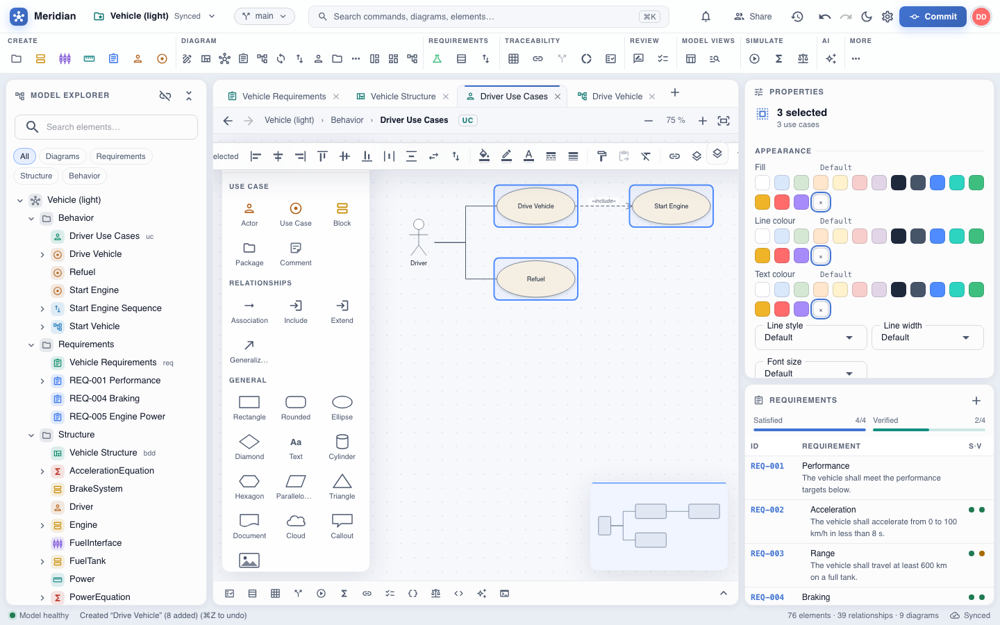
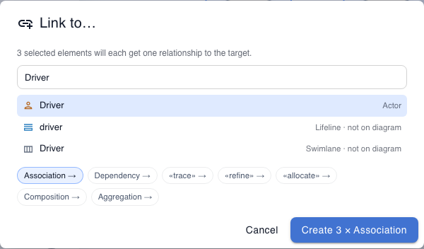

# Multi-select and bulk editing

Select many shapes and connectors on a diagram, then change their look, apply stereotypes or link them all to one
element in a single step.

## Select many

| To | Do this |
| --- | --- |
| add or remove a shape or connector | **Shift-click** or **⌘-click** (Ctrl-click) it |
| select everything inside an area | drag a box on empty canvas; connectors whose path lies inside are picked up too |
| select every shape and connector | **⌘A** (Ctrl+A) |
| clear the selection | **Esc**, or click empty canvas |
| add on a touch screen | long-press in edit mode |

Every selected connector gets a halo, and the selection bar shows how many items are selected. Right-click part of a
selection to keep it and open the multi-selection menu.

<picture>
  <source media="(prefers-color-scheme: dark)" srcset="../images/multi-select-dark.png">
  
</picture>

## Edit them together

With more than one item selected, the Inspector shows **N selected**:

- **Appearance**: fill, line and text colour, line style, line width and font size. Where the items differ the control
  says **Mixed**.
- **Stereotypes**: apply one to every selected element, or remove it from all of them.
- **Fields** the elements share, when they are all of one kind.
- **Actions**: **Link to…**, **Trace to requirement…**, **Reset look**, **Remove from diagram** and
  **Delete from model**.

Each change is **one undo step**, however many items it touches.

The right-click menu also has **Align** (left, centres, right, top, middles, bottom), **Distribute** (three or more
shapes), **Copy**, **Duplicate** and paste.

## Link to…

**Link to…** gives every selected element one relationship to a single target:

1. Right-click the selection ▸ **Link to…** (or use the Inspector's action).
2. Search for the target and click it. Elements not on the diagram are marked *not on diagram*.
3. Pick the relationship kind. Only kinds that are valid for the whole selection are offered, and the most fitting one
   is already chosen (for example **Association** between use cases and an actor).
4. **Create N × …** adds them all, draws them and shows the target, as one undo step.

<picture>
  <source media="(prefers-color-scheme: dark)" srcset="../images/link-to-dark.png">
  
</picture>

**Trace to requirement…** does the same with requirements only, and picks the fitting link: «satisfy» from design
elements, «verify» from test cases, «deriveReqt» between requirements.

## Lines pick their own type

When you draw a line with the hover arrows, Meridian picks the relationship from the diagram and the two ends:

| Between | The line becomes |
| --- | --- |
| actor and use case | association |
| two use cases | «include» |
| a design element and a requirement | «satisfy» (drawn from either end) |
| two requirements | «deriveReqt» |
| a test case and a requirement | «verify» |
| two blocks on a BDD | composition |
| parts or ports on an IBD | connector (binding connector on a parametric diagram) |
| states | transition |
| actions | control flow (object flow to an object node) |
| packages | dependency |
| a behaviour and a structure | «allocate» |

The new line shows a chip with its type. Click the chip to switch to another valid type: it is one undo step and keeps
the line's bends and label.
