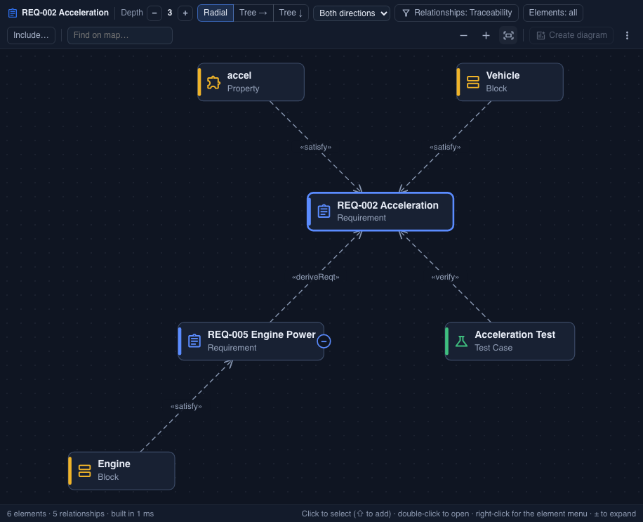

# Relation map

A relation map shows everything connected to one element, level by level: what satisfies and verifies a requirement,
what a block is made of and allocated to, what depends on it. It works like Cameo's *Relation Map*. You can explore the
map one node at a time, re-centre it on any element, and turn a selection into a real diagram.

## Opening a map

- Right-click an element in the model explorer or on a diagram, then choose **Relation map**.
- Select an element, then click the **Relation map** button (hub icon) at the top of the **Properties** panel.
- Press **⌘K** and type *Relation map of …*, for example `Relation map of REQ-002`. *Relation map of selection*
  maps whatever is selected.
- Select an element, then choose **Traceability → Relation map** on the ribbon.

The map opens as a tab next to your diagrams. A map of a **requirement** starts on its traceability links: satisfy,
verify, deriveReqt, refine, trace and copy.

## Controls

| Control | What it does |
| --- | --- |
| **Depth − / +** | How many levels to show from the centre, from 1 to 6. |
| **Radial / Tree → / Tree ↓** | Lay the map out in rings around the centre, or as a tree growing to the right or downwards. |
| **Both directions / Outgoing / Incoming** | Which relationships to follow. Outgoing follows relationships whose source is the element. |
| **Relationships** | A checklist of relationship kinds, plus four presets: **Traceability** (satisfy, verify, deriveReqt, refine, trace, copy), **Structure** (associations, compositions, aggregations, generalizations, realizations, dependencies, connectors, binding connectors), **Allocation** (allocate) and **All**. |
| **Elements** | Element kinds to show. The centre element always shows. |
| **Include…** | Containment, meaning **owned elements** and the **owner**. Also **used-project (library) elements** and **code-synced elements** (both on by default). |
| **Find on map** | Highlights the nodes whose name contains the text. Press Enter to centre the first match. |
| **− / + / Fit** | Zoom. You can also use the mouse wheel or a trackpad pinch. Drag the background to pan. |

Each box shows the element's icon, name and kind. Requirements show their id. Each line shows the relationship's
«stereotype» and name, and an arrowhead in the relationship's own notation. A dotted line with ⊕ at the owner means
containment. Elements from a used project carry a purple **LIB** badge: they are read-only, and the tooltip names
the project and its version. Code-synced elements carry a green **&lt;/&gt;** badge.

## Exploring

- **Click** a node to select it. Its properties appear in the Properties panel. Use **⇧-click** (or ⌘-click) to add
  nodes to the selection. Click the background to clear the selection.
- Click the **+** on the right edge of a node to expand it: the node's neighbours appear, even beyond the depth. The
  tooltip says how many are hidden. Click **−** to collapse it again. This way you can explore a large model a little
  at a time.
- **Double-click** a node to open its diagram (a diagram it owns, or the diagram itself). Otherwise the node is
  selected in the model explorer.
- **Right-click** a node for the usual element menu. It begins with **Re-centre on this element**,
  **Expand** / **Collapse** and **Create diagram from selection**.

### Large models

A map shows at most **500 elements**. Each node shows at most 40 neighbours at first. Beyond that, a dashed
**"+N more"** box stands for the rest; click it to show the next 40. The status bar under the map says when the map
was cut short, how many elements and relationships it shows, and how long it took to build.

The map follows the model's relationship index, so the time it takes depends only on what is shown, not on the size of
the model. On the 200,000-element benchmark model, a depth-6 map builds and lays out in a few milliseconds (see
`docs/PERFORMANCE.md`).

## Turning a selection into a diagram

Select some nodes, then click **Create diagram** (or use the node menu). Meridian makes a real diagram of those elements
and the relationships between them. The diagram is laid out automatically, saved in the centre element's package and
opened as a tab. If the selection contains requirements or test cases, the diagram is a requirement diagram. Otherwise
it is a block definition diagram. One **undo** removes the diagram.

## Saving and exporting

- An open map keeps its settings in its tab, including across a library update or a merge.
- Choose **⋮ → Save as view in the model…** to save the map as a **Relation Map** element in the *Views* package.
  It works like Cameo's relation map element: double-click it in the model explorer, or use ⌘K *Open relation map: …*,
  to open it again with the same centre, depth, filters, layout and expanded nodes. Saving again updates the element,
  and **Save as new view…** makes a copy.
- Choose **⋮ → Export as SVG** or **Export as PNG** to download the whole map as a picture.

## In reports

Report templates have a **Relation map** block. Give it one of these:

- **A saved relation map**, by name.
- **A root element**: a name, a qualified name, a requirement id such as `REQ-002`, or `{id}` inside a loop. If you
  leave it empty, the block uses the current loop element.

You can also set the **depth**, a **relationships** preset or a list of kinds, the **direction**, the **layout**,
containment and the most elements to draw. The map becomes a numbered figure ("Figure 3-1: Relation map of
Acceleration"). For example, put it inside *For each requirement* to give every requirement its trace picture.

## Permissions

Elements in packages that are hidden from you (see [Package permissions](permissions.md)) never appear on a map, and
neither do relationships with a hidden end. If the centre element itself becomes hidden, or is deleted, the map
says so instead of drawing anything.
