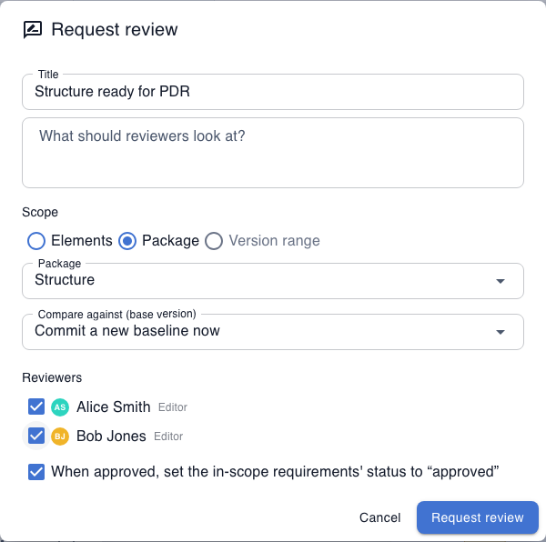

# Reviews and comments

## Comments on elements

Every element has a **Comments** section in the inspector. Write a comment, **Reply** to start a thread, and
**Resolve** a thread when it is done (**Reopen** brings it back). Comments are kept with the project, including in
the desktop app's local workspace.

On a server:

- Type `@` and a name to **mention** a project member; they get a notification.
- The element's **Owner** (set in the comments section) is notified about new comments on that element.
- The bell in the title bar lists your notifications (mentions, review requests, votes and state changes, comments).
  Click one to jump to the element or review; **Mark all read** clears the list.

## Review requests

A review asks one or more people to look at part of the model and approve it or request changes. Reviews double as
checklists: each reviewer ticks off the items they have looked at.

### Requesting a review

Select what should be reviewed and choose **Traceability → Request review** on the ribbon. In the desktop app's local mode the same
button creates a review checklist for yourself.

| Field | Choices |
| --- | --- |
| **Title** and **What should reviewers look at?** | free text |
| **Scope** | **Elements** (the ones you list; add more with *Add element…*), **Package** (a package and everything in it) or **Version range** (all changes between two versions) |
| **Compare against** | a committed version or baseline, *No baseline (no diff)*, or **Commit a new baseline now**; the head is the live model or a later version |
| **Reviewers** | project members (share the project first) |
| **When approved, set the in-scope requirements' status to "approved"** | optional |

<picture>
  <source media="(prefers-color-scheme: dark)" srcset="../images/request-review-dark.png">
  
</picture>

### Working through a review

**Traceability → Reviews** opens the *Reviews* dock tab. Filter the list by *Open*, *Waiting for me*, *Mine* or *Closed*,
then open a review:

- **Scope** lists the elements to review. Click one to select it on the diagrams; **Mark as reviewed** ticks it off.
- **Changes** shows what changed in scope since the base version, with field-level differences.
- **Discussion** holds review comments, either *General* or on a specific element, with replies.
- **Approve** or **Request changes** records your vote.

The review state follows the votes: any *request changes* makes it **Changes requested**; when every reviewer approves
it becomes **Approved**. The author can **Close** and **Reopen** a review and delete it.

When a review that has the *approved status* option is approved, **Mark approved** sets `status = approved` on the
requirements in scope (and the requirements they own) as one undoable step.
