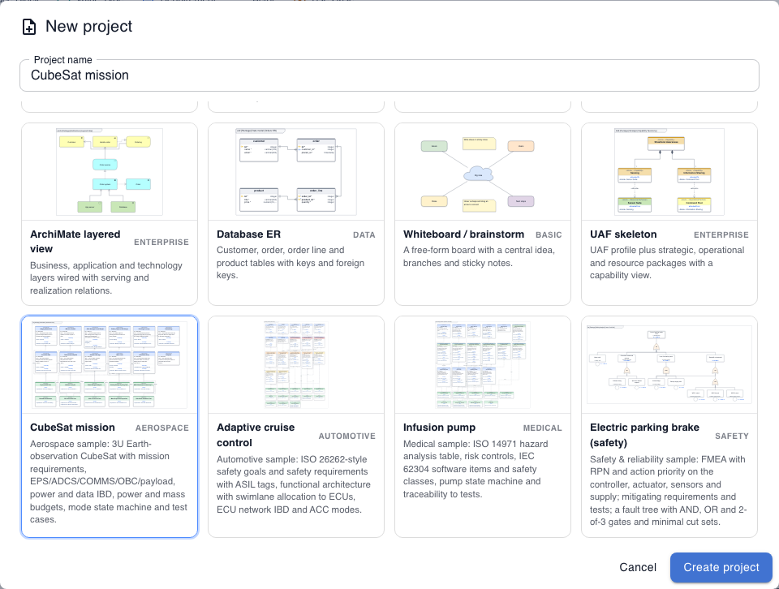

# Sample projects

**New project…** opens the template gallery. The *Basic*, *SysML*, *Business*, *Enterprise* and *Data* templates are
starting points; the four worked examples below are complete models that validate cleanly and show how the features
fit together. Each opens with every diagram laid out, saved tables and rules in a `Views` package, and test cases
with verdicts.

<picture>
  <source media="(prefers-color-scheme: dark)" srcset="../images/samples-gallery-dark.png">
  
</picture>

## Vehicle sample (SysML)

A passenger vehicle: performance, range, braking and engine requirements; vehicle, engine, fuel tank and brake
blocks; an IBD; acceleration and power parametrics; use cases; a *Start Vehicle* activity; an engine state machine; a
start-up sequence diagram; and verification test cases. It is the model used in most examples in this guide.

## CubeSat mission (Aerospace)

A 3U Earth-observation CubeSat in a 500 km sun-synchronous orbit.

| Area | Content |
| --- | --- |
| Requirements | mission, imaging resolution, lifetime, disposal, power margin, battery depth of discharge, pointing, detumbling, downlink and uplink rates, storage, mass and safe-mode requirements (`SAT-…`), with priority, status, verification method and an *Area* attribute |
| Architecture | *CubeSat* with EPS (solar array, battery), ADCS, COMMS, OBC, payload and frame; a mission context with the ground station and operator |
| Interfaces | `PowerBus`, `DataBus` and `RFLink` interface blocks typing proxy ports |
| IBD | *Power and Data Flow*: the EPS feeds every subsystem, the OBC is the data hub; connectors carry item flows (power, housekeeping, attitude commands, telemetry, image data) |
| Parametrics | *Power Budget* (consumption and orbit-average margin) and *Mass Budget*, with Monte Carlo distributions on the uncertain inputs |
| Behaviour | *Operating Modes* state machine (deployment, detumbling, commissioning, nominal with idle / imaging / downlink, safe, end of life) using `after(…)`, `when(…)` and signal triggers; a timed *Acquire Image* activity whose swimlanes allocate actions to ADCS, payload and OBC; a *Ground Pass* sequence |
| Trade study | *Battery Selection* across three battery options (energy, mass, cost, cycle life with a utility curve) |
| Verification | ten test cases, analyses and inspections; one *fail* verdict (downlink rate) and one not yet run |
| Views | *Requirement status*, *Verification status* and *Subsystems* tables; *Unverified requirements* and *Failed tests* queries; a *Payload resolution* rule |

**Deliberate gap:** `SAT-004 Disposal` is *proposed* and has no design or test yet, so Validate shows one REQ-003
warning and the traceability table one gap.

## Adaptive cruise control (Automotive)

An ACC item with an ISO 26262-flavoured safety concept. The ASIL ratings are illustrative, not the outcome of a real
hazard analysis and risk assessment.

| Area | Content |
| --- | --- |
| Profile | *ISO 26262* with «SafetyGoal», «FunctionalSafetyRequirement», «TechnicalSafetyRequirement» (tag `ASIL`) and «ECU» (tags `asilCapability`, `supplier`) |
| Requirements | functional requirements `ACC-001…007` (QM); safety goals `SG-01…03` refined by functional (`FSR-…`) and technical (`TSR-…`) safety requirements through *deriveReqt* |
| Functional architecture | the *ACC Control Loop* activity (fork / join, decision with guards, 20 ms of timed actions) and *Driver Override*, with one swimlane per ECU; every action is allocated to its ECU |
| Physical architecture | radar, front camera, ADAS ECU, engine ECU, brake ECU and instrument cluster; the *ACC Network* IBD with typed signals |
| Behaviour | *ACC Modes* state machine (off, standby, active, override, fault) and driver use cases |
| Verification | unit, HIL, track and vehicle tests, including the safety validation of the safety goals |
| Views | *Safety requirements by ASIL*, *Function allocation* and *ECU overview* tables; *Safety requirement verification* and *Unallocated functions* rules |

**Deliberate gap:** `ACC-007 Stop and Go` is *proposed*, planned for a later release.

## Infusion pump (Medical)

A large-volume infusion pump with ISO 14971-style risk management and IEC 62304-style software items. Clinical values
are illustrative.

| Area | Content |
| --- | --- |
| Profile | *Medical Device* with «Hazard» (hazard id, hazardous situation, harm, severity, probability, initial and residual risk), «RiskControl» (control type) and «SoftwareItem» (safety class) |
| Risk management | seven hazards, from free-flow over-infusion to an alarm not being heard |
| Requirements | system requirements `PUMP-…`, risk controls `RC-…` that *trace* to the hazards they mitigate, and software requirements `SWR-…` derived from the risk controls |
| Architecture | pumping mechanism, occlusion sensor, air detector, user interface, power supply, alarm unit, safety monitor and main controller; four software items with safety class A–C |
| Behaviour | *Pump States* (self test, programming, infusing, paused, alarm, KVO, fault) and the *Program Infusion* workflow with the drug-library limit check |
| Verification | bench, software and usability tests; the watchdog test *failed* (a CAPA is open) |
| Views | the **Hazard analysis** generic table (the hazard log), *Risk control verification*, *Software items* and *Test results* tables; *Hazard without risk control* and *Software safety class* rules |

**Deliberate gaps:** hazard *H-07 Alarm Not Heard* has no risk control yet (residual risk *TBD*), reported by the
*Hazard without risk control* rule; `PUMP-005 EMR Integration` is *proposed*.

## Electric parking brake (Safety)

An electric parking brake worked through FMEA and fault tree analysis. Ratings and probabilities are illustrative.

| Area | Content |
| --- | --- |
| Architecture | EPB system with brake controller, motor actuator, three wheel speed sensors and power supply (*EPB architecture* BDD, which lists each block's failure modes and RPN) |
| FMEA | four failure modes rated S / O / D, with effects, causes and recommended actions; requirements `EPB-010…012` mitigate three of them (*Mitigations* requirement diagram) |
| Fault tree | *Loss of hold fta*: OR, AND and 2-of-3 vote gates; *Undervoltage* appears twice, so the exact probability differs from the naive one |
| Verification | watchdog reset and stall injection tests |

**Deliberate gap:** *Wheel speed signal stuck* (RPN 245, AP H) has no mitigating requirement, reported by rule SAF-003.
See [Safety and reliability](safety.md).

## Using the samples

- Open the **Tables** tab and pick a saved table to see the requirement, verification or hazard views.
- Open **Traceability → Table** and tick *Not verified* to find the deliberate gaps.
- Try the simulations listed in [Simulation](simulation.md#try-it-on-the-samples).
- Edit a requirement's text and watch its links become suspect.
