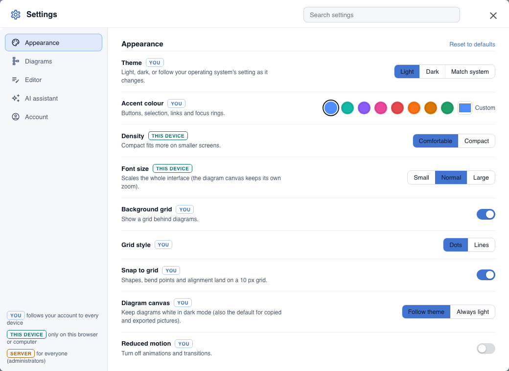
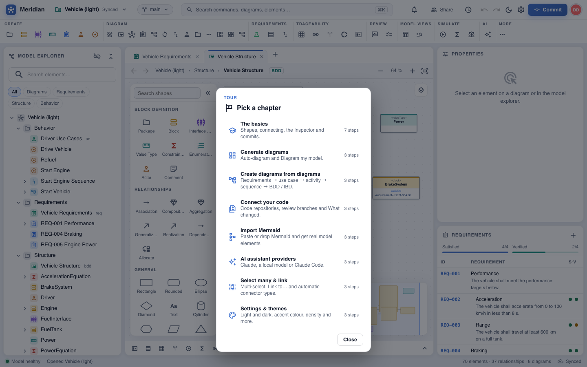

# Settings and theming

Open **Settings** with ⌘, (Ctrl+,), the gear in the title bar, or the project menu ▸ **Settings…**. Changes apply at
once; there is no Save button. Type in **Search settings** to find any setting by name or by a related word ("dark",
"snap", "ollama").

<picture>
  <source media="(prefers-color-scheme: dark)" srcset="../images/settings-appearance-dark.png">
  
</picture>

Each setting has a tag that says where it is kept:

| Tag | Meaning |
| --- | --- |
| **You** | saved with your account, so it follows you to every device |
| **This device** (**This computer** in the desktop app) | only on this browser or computer |
| **Server** | for everyone; only administrators can change it |

**Reset to defaults** puts one section back as it was.

## Appearance

| Setting | What it does |
| --- | --- |
| Theme | **Light**, **Dark** or **Match system** (follows your operating system as it changes). The sun / moon button in the title bar switches between light and dark in one click. |
| Accent colour | buttons, selection, links and focus rings; eight presets |
| Density | **Compact** fits more on smaller screens (per device) |
| Font size | scales the whole interface; the canvas keeps its own zoom (per device) |
| Background grid, Grid style | dots or lines behind diagrams |
| Snap to grid | shapes, bend points and alignment land on a 10 px grid |
| Diagram canvas | **Always light** keeps diagrams white in dark mode, and is then also the default for copied and exported pictures |
| Reduced motion | turns off animations and transitions |

The theme is drawn by the server before the first paint, so a reload never flashes the wrong colours.

## Diagrams

| Setting | What it does |
| --- | --- |
| Connector style for new diagrams | **Automatic** (routed lines, straight lines on whiteboards), **Orthogonal**, **Straight** or **Curved** |
| Line jumps | new diagrams draw a hop where connectors cross |
| Open diagrams as tabs | off: opening a diagram replaces the current tab |
| Show the shapes panel | open the shapes panel when the workbench starts |
| Zoom when a diagram opens | **Fit to window** or **100%** |

## Editor

| Setting | What it does |
| --- | --- |
| Confirm before deleting from the model | ask before **Delete** removes elements from the model (**Backspace** only removes them from the diagram) |
| Guided tour | **Show the tour again** restarts the first-run tour |
| Keyboard shortcuts | the full list; see also [Keyboard shortcuts](keyboard-shortcuts.md) |

## AI assistant

Turn the assistant on or off for yourself, pick the provider and the model, and enter an API key or a local model
server (desktop app). See [AI assistant](ai-assistant.md).

## Account, desktop and server

- **Account** (team server): display name, avatar colour, password, API tokens and **Sign out everywhere**.
- **Desktop** (desktop app): open the last workspace automatically, check for updates, recent files.
- **Server** (administrators): a link to the administration console. See [Administration](administration.md).

## The guided tour

The tour runs once, the first time you open Meridian on a desktop screen. It has chapters you can pick at any time from
the **Help (?)** menu in the title bar ▸ **Tour…**, from ⌘K ("Tour: …") or, on a phone, from the account menu ▸ **Tour…**:

| Chapter | Shows |
| --- | --- |
| The basics | shapes, connecting, the Inspector, requirements, ⌘K and commits |
| Coming from Cameo or EA | where the containment tree, specification window, palette and menus went |
| Generate diagrams | Auto-diagram and Diagram my model |
| Create diagrams from diagrams | Create from…, the plan, the derivation chain |
| Connect your code | code repositories, review branches, code changes and architecture checks |
| Import Mermaid | Paste Mermaid, dropping files, export |
| AI assistant providers | Claude, a local model and Claude Code |
| Select many & link | multi-select, bulk edits, Link to… and automatic connector types |
| Database modelling | importing a schema, the Database tab, subject areas |
| Used projects (shared libraries) | using a package of another project, updates, library elements in the tree |
| Verify requirements | criteria, Simulate ▸ Verify, variants |
| Permissions & requirements tools | package permissions, DOORS Next and Polarion, branches and reviews |
| Settings & themes | this page in three steps |

<picture>
  <source media="(prefers-color-scheme: dark)" srcset="../images/tour-chapters-dark.png">
  
</picture>

On a phone each step is a card at the bottom of the screen. After an upgrade, a **What's new** card lists what the
release added, once, with a **Show me** button for each item. It is also in the **Help (?)** menu.
