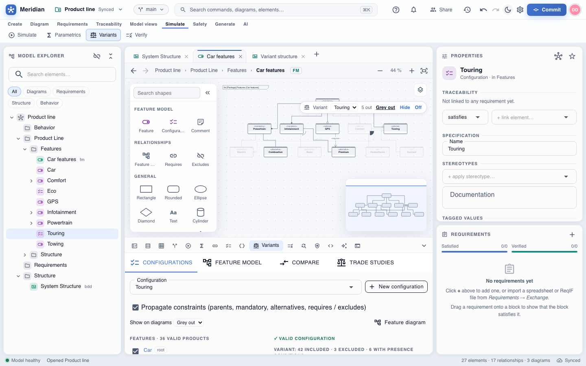

# Variants and trade studies

The **Simulate → Variants** ribbon button opens the *Variants & trades* dock tab, which has two tabs:
**Configurations** (product lines) and **Trade studies**.

## Product lines and variants

Meridian models a product line as a **150 % model**: one model that contains every option, with **presence
conditions** saying which elements belong to which variant.

### Features

A **feature model diagram** (ribbon **Diagram → More**, or **+ → Feature Model Diagram**) holds **features** in a tree.
Each feature has a **feature kind** relative to its parent:

| Kind | Meaning |
| --- | --- |
| mandatory | always selected when the parent is |
| optional | may be selected |
| alternative | exactly one of the alternative siblings (xor group) |
| or | at least one of the or-siblings |

Draw **Feature Decomposition** from parent to child (nesting a feature inside another in the model explorer works too),
**Requires** and **Excludes** for cross-tree constraints. Features can carry tagged values such as `cost` or `mass`,
which trade studies can add up per configuration.

**Add example product line** creates a small car product line (powertrain, infotainment, GPS, comfort, towing) to
experiment with.

### Presence conditions

Any element or relationship can have a **presence condition** (inspector): a feature expression such as `Electric`,
`GPS and not Basic` or `Towing or Premium`. An empty condition means "in every variant".

### Configurations

A **configuration** is a selection of features. In the Configurations tab:

1. **New configuration**, or pick one.
2. Tick features. *Auto-select parents, mandatory & required* keeps the selection consistent as you click.
3. Meridian checks the selection against the feature model (missing mandatory features, alternative groups,
   requires / excludes) and shows the problems.
4. The list below shows every element with a presence condition and whether it is **in the variant**.
   *Highlight excluded on diagrams* greys out excluded shapes on open diagrams.

To use a variant elsewhere:

- **Export variant (.meridian)** writes a project file containing only the elements of that variant.
- **New project from variant** creates a project from it directly.
- **Inclusion CSV** exports the element-by-configuration inclusion table.

<picture>
  <source media="(prefers-color-scheme: dark)" srcset="../images/variants-touring-dark.png">
  
</picture>

## Trade studies

A **trade study** compares alternatives against weighted criteria (a weighted-sum decision matrix). It is stored in
the model as a *Trade Study* element, so it is versioned with the design it evaluates.

### Alternatives

Alternatives are blocks, classes, components or configurations. Each criterion reads a number from every
alternative:

| Source | Reads |
| --- | --- |
| property | the default value of a value property with that name (else a tagged value) |
| parametric | the value the [parametric solver](simulation.md#parametrics) computes for the alternative block |
| tag | a tagged value |

For a configuration, a criterion's value is the sum of the tagged values of its selected features (for example total
`cost`).

### Criteria

| Field | Meaning |
| --- | --- |
| **Criterion** / value name | what to read (defaults to the criterion name) |
| **Weight** | relative importance; weights are normalised to shares of the total |
| **Better** | maximize or minimize |
| **Normalize** | *min-max* (the worst alternative scores 0, the best 1) or *utility* with a piecewise-linear curve `x:u, x:u, …`, for example `2000:0, 5000:0.9, 8000:1` |

### Results

The tab ranks the alternatives by weighted score and shows each criterion's raw, normalised and weighted values.
Missing values are reported and scored 0.

- **Sensitivity** varies each weight from ×0.5 to ×1.5 (the others unchanged) and shows whether the winner or the
  ranking changes.
- **Winner changes at share** gives, per criterion, the weight share at which another alternative would win.
- **Export CSV** writes the decision matrix.

Follow [Your first trade study](../tutorials/first-trade-study.md) for a worked example with the CubeSat sample.
