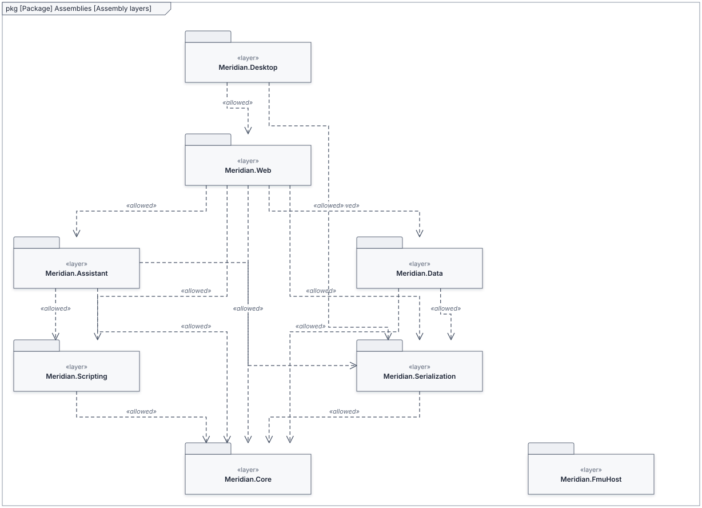
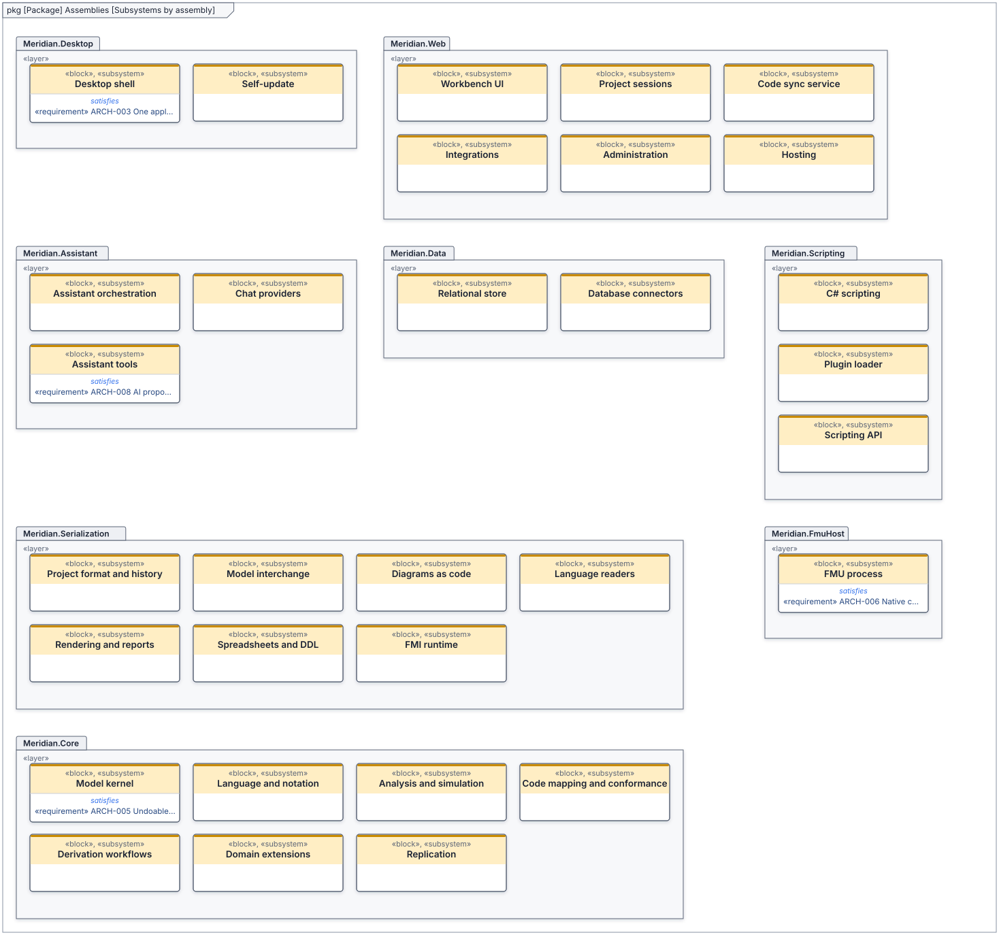
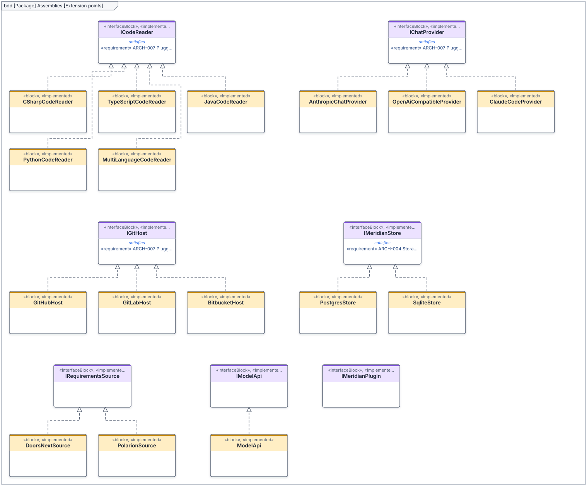
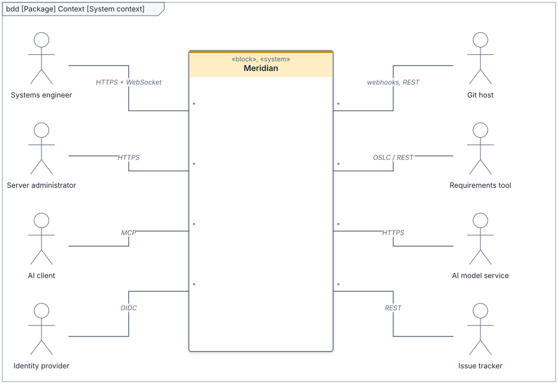
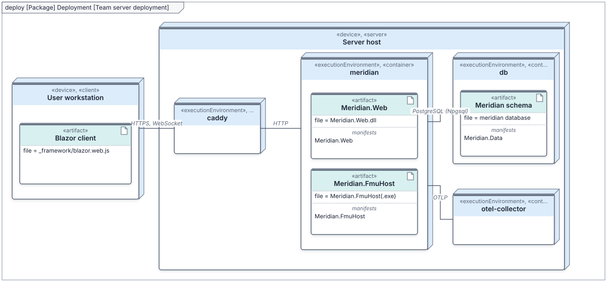
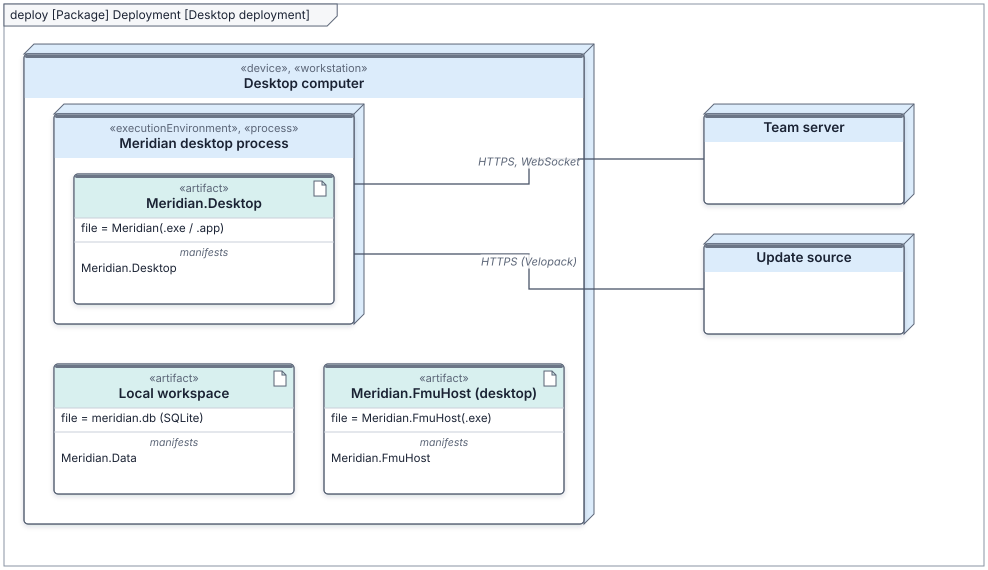
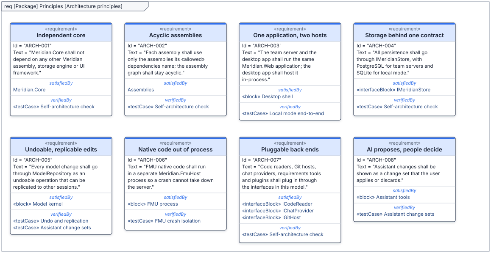
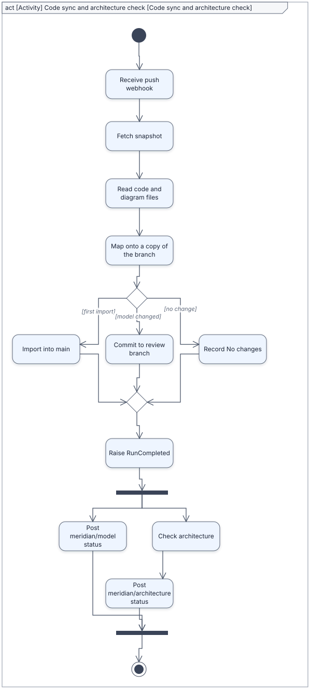

# Meridian's architecture

Meridian's architecture is modeled in Meridian: [`docs/architecture/Meridian.meridian`](architecture/Meridian.meridian).
The model is the reference. Its assembly layers and extension points are checked against `src/` on every test run by
Meridian's own [architecture checks](ARCHITECTURE-CHECKS.md), so the diagrams below cannot silently drift from the code.

**Open it** in the Meridian desktop app or on a team server like any other `.meridian` file.

| Package | What it holds |
| --- | --- |
| Principles | Eight architecture principles (ARCH-001 … ARCH-008), what satisfies them and the tests that verify them |
| Context | Meridian and the people and systems it works with |
| Assemblies | One «layer» package per assembly under `src/`, with its subsystems and its «implemented» extension points |
| Deployment | The team server (Docker Compose) and the desktop app |
| Behavior | What one push to a connected repository does, through to the architecture check |

## Assembly layers

Each «layer» package maps one assembly by its `namespaces` tag. Its «allowed» dependencies are the only other assemblies
its code may use, and each one is used. `Meridian.Core` and `Meridian.FmuHost` allow none. Two edges differ from the
`<ProjectReference>` graph: `Meridian.Desktop` uses `Meridian.Serialization` through its reference to `Meridian.Web`,
and `Meridian.Web` references `Meridian.FmuHost` only to ship the executable, which runs as a child process.

<picture>
  <source media="(prefers-color-scheme: dark)" srcset="architecture/assembly-layers-dark.svg">
  
</picture>

## Subsystems by assembly

<picture>
  <source media="(prefers-color-scheme: dark)" srcset="architecture/subsystems-by-assembly-dark.svg">
  
</picture>

Each subsystem's documentation in the model names the namespaces it covers. Subsystems are deliberately not named after
code types, so they describe the code without being mapped to it.

## Extension points

Every block here is «implemented» and named after its code type. The checks report an interface block whose
implementation stops implementing it, and an «implemented» element whose type was renamed or removed.

<picture>
  <source media="(prefers-color-scheme: dark)" srcset="architecture/extension-points-dark.svg">
  
</picture>

## System context

<picture>
  <source media="(prefers-color-scheme: dark)" srcset="architecture/system-context-dark.svg">
  
</picture>

## Deployment

<picture>
  <source media="(prefers-color-scheme: dark)" srcset="architecture/team-server-deployment-dark.svg">
  
</picture>

<picture>
  <source media="(prefers-color-scheme: dark)" srcset="architecture/desktop-deployment-dark.svg">
  
</picture>

## Architecture principles

<picture>
  <source media="(prefers-color-scheme: dark)" srcset="architecture/architecture-principles-dark.svg">
  
</picture>

## Code sync and the architecture check

<picture>
  <source media="(prefers-color-scheme: dark)" srcset="architecture/code-sync-and-architecture-check-dark.svg">
  
</picture>

## How it is enforced

[`tests/Meridian.Tests/SelfArchitectureTests.cs`](../tests/Meridian.Tests/SelfArchitectureTests.cs) runs in the normal test
suite (CI included):

| Test | Fails when |
| --- | --- |
| `Source_Conforms_To_The_Architecture_Model` | `src/` breaks a layering, dependency or interface rule, or an «implemented» element has no code type |
| `Layering_Check_Catches_A_Dependency_The_Model_Does_Not_Allow` | the layering rule stops catching a real dependency (a guard on the check itself) |
| `Every_Assembly_Under_Src_Is_A_Layer_Of_The_Model` | an assembly is added under `src/` without a «layer» package |
| `Model_Passes_Meridians_Own_Validation` | Meridian's model validator reports any issue |
| `Diagram_Images_Match_The_Model` | the SVGs in `docs/architecture/` differ from the model's diagrams |

The suite reads all of `src/` with `CSharpCodeReader` once per run. Expect about one minute.

## Changing the architecture

1. Edit `docs/architecture/Meridian.meridian` in Meridian and save it.
   - New assembly: add a «layer» package under *Assemblies* with the tag `namespaces` set to the assembly name, and an
     «allowed» dependency to each assembly it references.
   - New dependency between assemblies: add the «allowed» dependency in the model first, then the `<ProjectReference>`.
2. Refresh the images:

   ```powershell
   $env:MERIDIAN_UPDATE_ARCHITECTURE_DOCS = '1'; dotnet test tests/Meridian.Tests --filter "FullyQualifiedName~SelfArchitectureTests"; Remove-Item Env:MERIDIAN_UPDATE_ARCHITECTURE_DOCS
   ```

3. Commit the model and the images together.

## Settings

The model root carries the check settings ([ARCHITECTURE-CHECKS.md](ARCHITECTURE-CHECKS.md)):

- `architecture.disabledRules = missing-in-model`: the model names subsystems and extension points, not all ~1,500 types.
- `architecture.suppressions` is empty. If you must accept a violation, add an entry with a `#` comment that names the
  fix, so the debt stays visible.

## Limits

- Only C# under `src/` is read. Razor markup (`.razor`), tests, benchmarks and samples are not checked.
- Subsystem blocks are documentation. Only «layer» packages and «implemented» elements are enforced.
